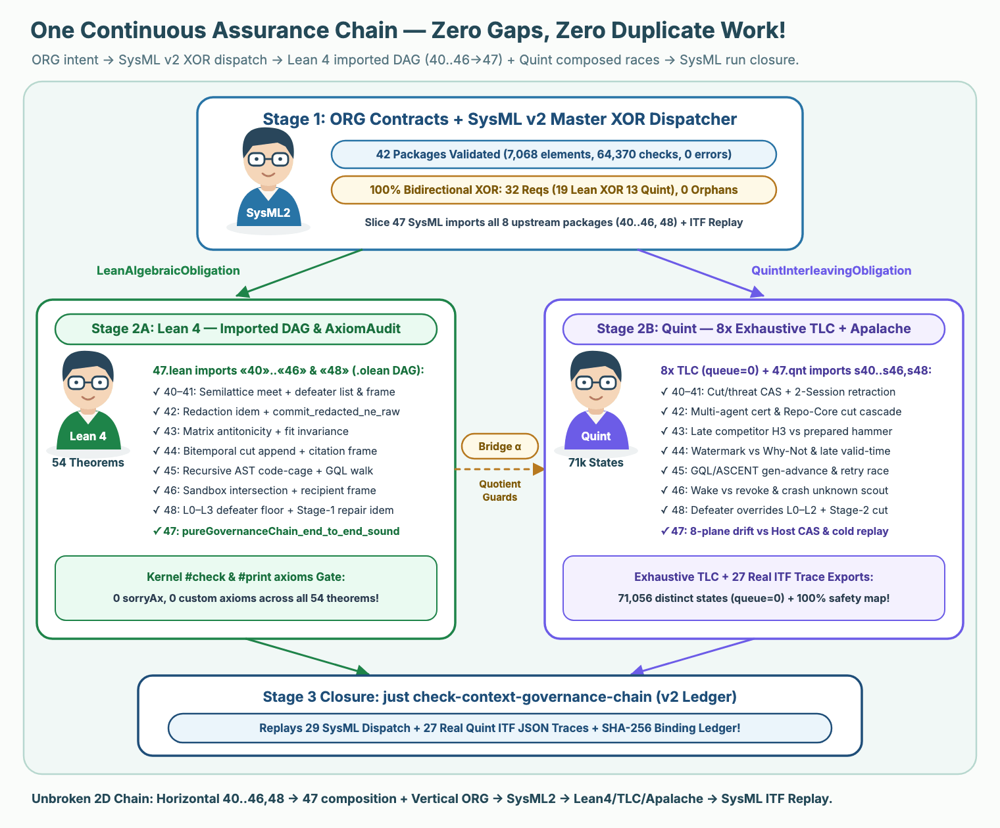

#+title: Context System Governance: Boundary, Trust Lattice and Threat-Gated Handoff
#+date: [2026-11-20]
#+language: en
#+property: STATUS design-and-formal-models-verified-no-scheme-changes
#+begin_comment
SPDX-FileCopyrightText: 2026 tao3k team and Contributors
SPDX-License-Identifier: Apache-2.0 AND LGPL-2.1-or-later
#+end_comment

* Scope and ownership boundary

This slice connects the [[file:01-system-boundary.org][Agentic AI Context architecture]] with Enterprise
Security Governance ([[file:../../../../packages/proofs/quint/GovernanceCore.qnt][Quint GovernanceCore]] and
[[file:../../../../packages/proofs/lean/AgenticAILabProof/Enterprise/GovernanceThreatAssuranceClosure.lean][Lean GovernanceThreatAssuranceClosure]]) without introducing an extra upper
manager or landing any Scheme implementation changes.

The companion [[file:41-epistemic-consolidation-governance.org][Slice 41]] owns epistemic multi-hypothesis projection under finite
budgets, =OmittedAlternativesReceipt=, and short-to-long Memory consolidation
governance. This slice owns the overall six-plane responsibility boundary,
trust-role taint isolation with endorsed promotion, restriction-envelope lattice
composition, cross-domain KV-prefix isolation, and threat-gated Provider
handoff.

* Six orthogonal planes and four non-interchangeable orders

Following [[file:00-design-map.org][the existing source allocation]], one semantic owner answers each
question:

| Plane | Semantic owner | Owned responsibility | Explicit non-authority |
|-------+----------------+----------------------+------------------------|
| P1 Source and addressing | Orgize + ORG Contract | Addressable =(Project, Repo, WorktreeCut, SourceID, Generation, ByteSpan)= Elements and declared external-artifact references | Source blocks, TODO states and links carry zero execution, import or grant authority |
| P2 Graph composition and Query | Unified Query (GQL) + =GraphContextComposition= | Bounded structural windows over ORG Elements; Project, Repo, Worktree, Work, WorkTrunk and Task composition | C3/C4 prototype precedence is not retrieval; shared content transfers neither grants nor reviews |
| P3 Epistemic and causal support | Temporal-Causality (ASCENT + Support/Impact) | Original positive proofs, competing hypotheses, active defeaters and =prepare-before-publish= invalidation | Hypothetical model fit and missing-claim counts neither authenticate evidence nor authorize effects |
| P4 Knowledge evolution | Optional =Context::Memory= Feature | Short-term observations and versioned long-term abstractions anchored to actual outcomes and defeat conditions | Retention horizon, age and read frequency never establish truth or current applicability |
| P5 Context Governance | Governance | Trust-role non-escalation, endorsement SoD, threat-phase blocking and inert readiness assessment | Assessments never execute actions or manufacture runtime grants (=carriesActionAuthority = false=) |
| P6 Interaction and runtime fence | Independent Session + Cedar / Host | =Session/Task/Attempt/Turn= lifecycle in Session; atomic current-cut, grant and prefix-isolation checks in Cedar/Host | Session never imports Context implementation; Host never invents upstream proof facts |

Four distinct orders coexist across these planes and must never be conflated:

1. *Prototype precedence order* ($\mathrm{Lin}_{\mathrm{C4}}(M)$): resolves slot
   inheritance on declared prototype edges only; $\mathrm{Lin}_{\mathrm{C4}}(M) \neq \mathrm{Safety}(M, \Sigma)$.
2. *Revision provenance order* ($\mathrm{derives}(v_0, v_1)$): immutable snapshot
   ancestry across edits and re-projections.
3. *Causal and epistemic support order*: premise, rule-derivation and defeater
   edges maintained by ASCENT and truth-maintenance owners.
4. *Prompt serialization and token-prefix order*: presentation layout for a
   target model, carrying zero policy override or trust-promotion semantics.

Five state coordinates remain orthogonal for every Context slice: retention
horizon, epistemic status, temporal applicability, governance threat readiness,
and runtime grant/fence consumption.

* Threat taxonomy for the Context System

| Threat ID | Name | Primary boundary | Blocking condition |
|-----------+------+------------------+--------------------|
| =T-CTX-01= | Indirect instruction injection | Gate 1 (Ingress & trust role) | Untrusted external or tool text enters an intent or policy slot without a qualified =EndorsementReceipt= |
| =T-CTX-02= | Privilege or scope widening | Gate 2 (Composition meet) | Child override or cross-Worktree composition widens readers, destinations, capabilities or half-open leases |
| =T-CTX-03= | Defeater or caveat stripping | Gate 2 (Slice 41 projection) | Budget compaction drops active defeaters, open contradictions or mandatory restriction metadata |
| =T-CTX-04= | Cross-domain KV-prefix leakage | Gate 4 / Host prefix fence | Identical rendered token prefix reused across distinct tenants, principal scopes or restriction digests |
| =T-CTX-05= | Memory consolidation poisoning | Gate 3 (Slice 41 Memory) | Unverified turn output or self-approved summary promoted into reusable long-term knowledge |
| =T-CTX-06= | Active threat at Provider handoff | Gate 4 (Handoff readiness) | Any =high= or =critical= threat in =exposed= or =realized= phase on the bound Context slice |
| =T-CTX-07= | Stale residual-risk or endorsement reuse | Gate 1 & Gate 4 cut fence | Source cut advances after an =EndorsementReceipt= or =accepted= residual threat without fresh re-binding |

* Mathematical specification

** Trust-role lattice and endorsed promotion (Gate 1)

Every Context Element carries a trust-role coordinate in the finite chain
$(\mathcal{T}, \preceq)$:

#+begin_src typst
$ upright("UntrustedData") prec upright("ObservedFact") prec upright("ModelProposal") prec upright("UserIntent") prec upright("SystemPolicy") $
#+end_src

Query selection, cross-file link traversal ([[file:35-org-context-modules.org][Slice 35]]), graph composition, and
summarization are non-escalating operators. Promoting an input $x$ above its
premise role requires an explicit =EndorsementReceipt= $r$ satisfying Separation
of Duties and exact cut binding:

#+begin_src typst
$ upright("ValidEndorsement")(r, d, c_(upright("live")), p_(upright("prop"))) equiv
  (r.upright("digest") = d)
  and (r.upright("boundCut") = c_(upright("live")))
  and (r.upright("proposer") = p_(upright("prop")))
  and (r.upright("endorser") != r.upright("proposer")) $
#+end_src

Same-session self-endorsement ($r.\mathrm{endorser} = r.\mathrm{proposer}$) and
source-cut drift ($r.\mathrm{boundCut} \neq c_{\mathrm{live}}$) fail closed.

** Restriction-envelope lower semilattice

Each slice carries a restriction envelope
$R = (P_{\mathrm{read}}, D_{\mathrm{dest}}, K_{\mathrm{cap}}, [t_0, t_1), \tau_{\max}, \Omega_{\mathrm{obl}})$.
Composing slices $a$ and $b$ forms the meet $a \sqcap b$:

#+begin_src typst
$ a sqcap b = (
  P_a inter P_b,
  D_a inter D_b,
  K_a inter K_b,
  [max(t_(0,a), t_(0,b)), min(t_(1,a), t_(1,b))),
  min_(preceq)(tau_a, tau_b),
  Omega_a union Omega_b
) $
#+end_src

For any finite slice list $M = [m_1, \dots, m_n]$ seeded from $m_0$, the
composed envelope refines $m_0$ and every $m_i \in M$, ensuring that prototype
precedence or composition order can never widen visibility, destinations,
capabilities, lease intervals or trust ceilings, nor drop an obligation.

** Threat-gated Provider handoff and KV-prefix isolation (Gate 4)

A prepared projection $p$ with governance assessment $a$ is eligible for
Provider handoff only when:

#+begin_src typst
$ upright("HandoffEligible")(sigma, p, a) equiv
  upright("CutAndGrantCurrent")(sigma, p)
  and upright("RoleTransitionValid")(sigma, p)
  and (forall t in a.upright("threats"), not upright("IsBlocking")(t))
  and (forall t in a.upright("threats"), t.upright("phase") = upright("accepted") => t.upright("acceptedAtCut") = sigma.upright("liveCut"))
  and upright("SoD")(a.upright("proposer"), a.upright("approver"), a.upright("executor"))
  and not upright("CarriesActionAuthority")(a) $
#+end_src

Downstream KV-cache prefix reuse requires exact agreement on
$(\mathrm{tenantScope}, \mathrm{principalScope}, \mathrm{restrictionDigest}, \mathrm{modelTokenizerProfile}, \mathrm{tokenPrefix})$
together with a live read grant at the current source cut.

* SysML v2 Master Verification Taxonomy and Orthogonal Allocation

To prevent Lean 4 and Quint from duplicating responsibilities across Slices
=40=–=47=, [[file:40-context-governance-boundary.sysml][40-context-governance-boundary.sysml]] defines
=FormalVerificationTaxonomy=, which partitions every requirement into strictly
disjoint verification engines (=verifierSuite.leanEngine= XOR
=verifierSuite.quintEngine=):

|Artifact | Disjoint formal ownership | Explicitly excluded duplication |
|----------+---------------------------+---------------------------------|
| [[file:40-context-governance-boundary.sysml][40-context-governance-boundary.sysml]] | =FormalVerificationTaxonomy= (=LeanAlgebraicObligation= vs =QuintInterleavingObligation=), 3-plane ports, disjoint allocations and =GovernanceArchitectureAndDispatchContract= | Re-implementing Quint state machines or Lean induction |
| [[file:40-context-governance-boundary.lean][40-context-governance-boundary.lean]] | Unbounded algebra & induction ONLY: =minRole_idem=, =minRole_comm=, =minRole_assoc=, =foldRoles_le_every_premise=, =composeRestrictions_refines_every_member=, =kvDomainKey_injective=, and =governance_value_carries_zero_authority= | Single-step boolean state-transition wrappers |
| [[file:40-context-governance-boundary.qnt][40-context-governance-boundary.qnt]] | Nondeterministic (=nondet=) concurrency ONLY: endorsement inbox vs =advanceSourceCut= races, =exposeCriticalThreat= vs prepared handoffs, residual cut invalidation, and KV revocation fences | Static =control= bypass flags or lattice algebra |
| [[file:../../../../dev/d2/governance-illustrations.ts][governance-illustrations.ts]] + [[file:../../../../dev/d2/governance-figures.sysml][governance-figures.sysml]] | OpenSysML + =@deterministic-engineering/render= view  (=output/40-verification-dispatch.{svg,png,webp,html,receipt.json}=) | Runtime Scheme execution |

#+CAPTION: Slice 40 — FormalVerificationTaxonomy & Orthogonal Lean/Quint Dispatch

Reproduce all checks locally without touching Scheme sources:

#+begin_src sh
lean docs/10-19-design/10.06-poo-module-system/agentic-ai-context/40-context-governance-boundary.lean

sysml -strict -validate -self-check -no-record-cache \
  docs/10-19-design/10.06-poo-module-system/agentic-ai-context/40-context-governance-boundary.sysml

sysml -strict -no-record-cache \
  docs/10-19-design/10.06-poo-module-system/agentic-ai-context/40-context-governance-boundary.sysml \
  -engine run \
  -analysis 'ContextGovernanceBoundary::GovernanceArchitectureAndDispatchContract(true,true,true,true,0)' \
  -analysis 'ContextGovernanceBoundary::GovernanceArchitectureAndDispatchContract(true,true,true,true,1)' \
  -analysis 'ContextGovernanceBoundary::GovernanceArchitectureAndDispatchContract(true,true,true,false,2)'

quint typecheck docs/10-19-design/10.06-poo-module-system/agentic-ai-context/40-context-governance-boundary.qnt
quint test docs/10-19-design/10.06-poo-module-system/agentic-ai-context/40-context-governance-boundary.qnt \
  --main ContextGovernanceBoundary
quint verify docs/10-19-design/10.06-poo-module-system/agentic-ai-context/40-context-governance-boundary.qnt \
  --main ContextGovernanceBoundary --max-steps 8 --invariant safety
#+end_src

Local verification results on 2026-11-20:

- Lean checked all unbounded semilattice, list-fold and key-injectivity theorems
  with zero errors, warnings or =sorry=.
- Strict SysML validation across all 41 packages in =agentic-ai-context/=
  reported 6,870 elements, 62,542 checks, 0 violations and 0 unevaluated checks;
  =run= passed disjoint =mode = 0= and rejected modes =1..2=.
- Quint passed all 5 deterministic race and counterexample runs and symbolic
  =verify= held =safety= across 8 =nondet= steps with =NoError=.
- =@deterministic-engineering/render= exported =40-verification-dispatch= with
  =minimumTextSize = 17px= across 38 text samples.
