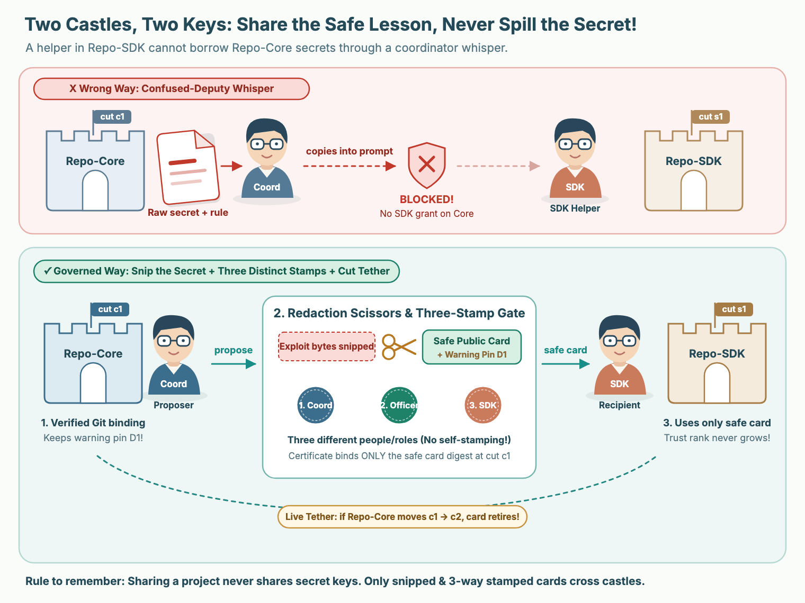

#+title: Cross-Repository Multi-Agent Context Sharing and Controlled Declassification
#+date: [2026-11-20]
#+language: en
#+property: STATUS design-and-formal-models-verified-no-scheme-changes
#+begin_comment
SPDX-FileCopyrightText: 2026 tao3k team and Contributors
SPDX-License-Identifier: Apache-2.0 AND LGPL-2.1-or-later
#+end_comment

* Research problem: confused-deputy Context forwarding in multi-agent workflows

In ordinary multi-agent harnesses and swarm coordinators, a parent or
coordinator Agent holding broad read access frequently summarizes or quotes
restricted repository findings into a subagent prompt or peer message. From an
information-flow control (IFC) perspective, this creates three structural
vulnerabilities:

1. *Confused-deputy ambient forwarding*: the subagent lacks a direct read grant
   on the restricted source repository, yet receives restricted claims through
   the coordinator's ambient read authority.
2. *Unauthenticated cross-repository aliasing*: a relative or named repository
   reference resolves against a Worktree label or remote URL spelling rather
   than independently authenticated Git and Worktree bindings
   ([[file:index.org][repository index]] and [[file:topology.org][repository topology]]).
3. *Unbounded declassification*: either reader intersection ($\sqcap$) blocks
   all legitimate cross-team collaboration, or ad hoc prompt summarization leaks
   raw sensitive payloads and silently escalates trust rank.

This slice extends [[file:35-org-context-modules.org][Slice 35]] and [[file:40-context-governance-boundary.org][Slice 40]] with a governed cross-repository,
multi-agent sharing and controlled redaction/declassification model. No Scheme
implementation files are added or modified.

* Concrete multi-repository ORG case

Project =platform-sec= spans two independently bound repositories:

- =Repo-Core= (Worktree =wt-audit= at source cut =c1=): Coordinator
  =agent-coord= holds read grant =grant-core-read= over
  =findings.org#vuln-root-cause=, which contains both an internal exploit vector
  and the public SDK boundary invariant, plus active defeater =D1=.
- =Repo-SDK= (Worktree =wt-sdk-fix= at source cut =s1=): Worker =agent-sdk=
  repairs downstream validation in =Repo-SDK= and holds =grant-sdk-rw=, without
  any direct read grant on =Repo-Core='s raw bytes.

The topology and redaction intent are expressed in ORG property drawers without
conferring authority by prose alone:

#+begin_example
* Cross-repo topology relation: platform-sec
:PROPERTIES:
:ID: topology-platform-sec-core-sdk
:CONTRACT_ID: context.topology.cross-repo.v1
:SOURCE_REPO_ID: repo-core
:SOURCE_GIT_COMMON_DIGEST: sha256:81a4...
:SOURCE_WORKTREE_DIGEST: sha256:19f0...
:SOURCE_CUT: c1
:TARGET_REPO_ID: repo-sdk
:TARGET_GIT_COMMON_DIGEST: sha256:44c2...
:TARGET_WORKTREE_DIGEST: sha256:72e9...
:TARGET_CUT: s1
:END:

* Redacted SDK handoff candidate
:PROPERTIES:
:ID: handoff-sdk-boundary-invariant
:CONTEXT_ORIGIN_REPO: repo-core
:CONTEXT_ORIGIN_SOURCE: findings.org
:CONTEXT_ORIGIN_ID: vuln-root-cause
:CONTEXT_ORIGIN_CUT: c1
:REDACTION_SPEC_ID: strip-exploit-retain-invariant-and-defeaters-v1
:REDACTED_OUTPUT_DIGEST: redacted-public-v1
:REQUIRED_DECLASSIFICATION_RECIPIENT: agent-sdk
:END:
#+end_example

See [[file:../../../../dev/d2/governance-illustrations.ts][the OpenSysML + @deterministic-engineering/render illustrated story]]
([[file:../../../../dev/d2/governance-figures.sysml][view specification]]) for the visual contrast between rejected ambient
coordinator forwarding and admitted dual-binding redacted declassification.

* Governance rules and mathematical model

** Non-transitivity under ordinary restriction meet

Under [[file:40-context-governance-boundary.org][Slice 40]]'s ordinary restriction meet, reader sets intersect:

#+begin_src typst
$ upright("Readers")(R_(upright("core")) inter.sq R_(upright("sdk"))) = upright("Readers")(R_(upright("core"))) inter upright("Readers")(R_(upright("sdk"))) $
#+end_src

Whenever $\mathrm{agent\text{-}sdk} \notin \mathrm{Readers}(R_{\mathrm{core}})$,
ordinary composition provably excludes $\mathrm{agent\text{-}sdk}$. Dispatching
a subagent or sharing a Project root transfers zero ambient read grants.

** Controlled escape via Redaction + Four-Role Declassification Certificate

Cross-repository disclosure of a derived slice to a recipient $u$ without a
direct origin read grant is admissible if and only if:

1. *Dual observed repository bindings*: both source and target repository/Worktree
   bindings are independently authenticated and linked by an admitted Project
   topology relation $\mathrm{TopologyVerified}(B_{\mathrm{src}}, B_{\mathrm{dst}})$.
2. *Pure redaction projection with defeater preservation*: a pure projection
   $\rho$ maps raw digest $d_{\mathrm{raw}}$ to $d_{\mathrm{red}} \neq d_{\mathrm{raw}}$
   while preserving active defeaters ($\mathrm{preservesDefeaters} = \top$).
3. *Declassification Separation of Duties*: an active =DeclassificationCertificate=
   $C$ binds $(c_{\mathrm{live}}, d_{\mathrm{red}}, u)$ under pairwise distinct
   proposer, declassifier and recipient:

#+begin_src typst
$ upright("ValidDeclassificationSoD")(C) equiv
  (C.upright("proposer") != C.upright("declassifier"))
  and (C.upright("recipient") != C.upright("declassifier"))
  and (C.upright("proposer") != C.upright("recipient")) $
#+end_src

4. *Raw-digest isolation and trust non-escalation*: $C$ authorizes delivery of
   $d_{\mathrm{red}}$ alone ($d_{\mathrm{delivered}} = d_{\mathrm{red}} \neq d_{\mathrm{raw}}$)
   and enforces $\tau_{\mathrm{recipient}} \le \tau_{\mathrm{origin}}$.
5. *Cascading withdrawal on cut drift or revocation*: advancing =Repo-Core= from
   $c_1$ to $c_2$ or revoking $C$ immediately withdraws current eligibility of
   the subagent's derived slice while retaining historical Attempt records.

* Orthogonal SysML v2 Verification Allocation and Local Verification

| Artifact | Disjoint formal ownership under =FormalVerificationTaxonomy= |
|----------+--------------------------------------------------------------|
| [[file:42-multi-repo-multi-agent-declassification.sysml][42-multi-repo-multi-agent-declassification.sysml]] | Dual topology & declassification ports + disjoint allocation to =leanEngine= XOR =quintEngine= (=MultiRepoDispatchAndBoundaryContract=) |
| [[file:42-multi-repo-multi-agent-declassification.lean][42-multi-repo-multi-agent-declassification.lean]] | Pure redaction operator & set algebra ONLY: =redactFields_idem=, =redactFields_preserves_defeaters=, =redactFields_strips_all_secrets=, =redactFields_length_le=, =commit_redacted_ne_raw=, and =ordinary_intersection_never_adds_ungranted_subagent= |
| [[file:42-multi-repo-multi-agent-declassification.qnt][42-multi-repo-multi-agent-declassification.qnt]] | Nondeterministic (=nondet=) multi-agent concurrency ONLY: asynchronous certificate issuance vs nested-subagent forwarding races, and =advanceRepoCoreCut= / =revokeCert= cascading withdrawals |
| [[file:../../../../dev/d2/governance-illustrations.ts][governance-illustrations.ts]] | OpenSysML + =@deterministic-engineering/render= illustrated view  (=output/42-declassification.{svg,png,webp,html,receipt.json}=) |

#+CAPTION: Slice 42 — Multi-Repo Multi-Agent Redacted Declassification & 3-Party SoD

Reproduce all checks locally without touching Scheme sources:

#+begin_src sh
cd dev/d2 && bun run check && bun run governance-figures
cd ../..

lean docs/10-19-design/10.06-poo-module-system/agentic-ai-context/42-multi-repo-multi-agent-declassification.lean

sysml -strict -no-record-cache \
  docs/10-19-design/10.06-poo-module-system/agentic-ai-context/40-context-governance-boundary.sysml \
  docs/10-19-design/10.06-poo-module-system/agentic-ai-context/42-multi-repo-multi-agent-declassification.sysml \
  -engine run \
  -analysis 'MultiRepoAgentDeclassification::MultiRepoDispatchAndBoundaryContract(true,true,true,true,0)' \
  -analysis 'MultiRepoAgentDeclassification::MultiRepoDispatchAndBoundaryContract(true,true,false,true,1)' \
  -analysis 'MultiRepoAgentDeclassification::MultiRepoDispatchAndBoundaryContract(true,true,true,false,2)'

quint typecheck docs/10-19-design/10.06-poo-module-system/agentic-ai-context/42-multi-repo-multi-agent-declassification.qnt
quint test docs/10-19-design/10.06-poo-module-system/agentic-ai-context/42-multi-repo-multi-agent-declassification.qnt \
  --main MultiRepoAgentDeclassification
quint verify docs/10-19-design/10.06-poo-module-system/agentic-ai-context/42-multi-repo-multi-agent-declassification.qnt \
  --main MultiRepoAgentDeclassification --max-steps 8 --invariant safety
#+end_src

Local verification results on 2026-11-20:

- Lean checked all pure redaction-operator and intersection theorems with zero
  errors, warnings or =sorry=.
- Strict SysML validation passed with zero violations; =run= passed guarded
  =mode = 0= and rejected modes =1..2=.
- Quint passed all deterministic runs and symbolic =verify= held =safety= across
  8 =nondet= transitions with =NoError=.
- =@deterministic-engineering/render= exported =42-declassification= with
  =minimumTextSize = 16px= across 40 text samples.
