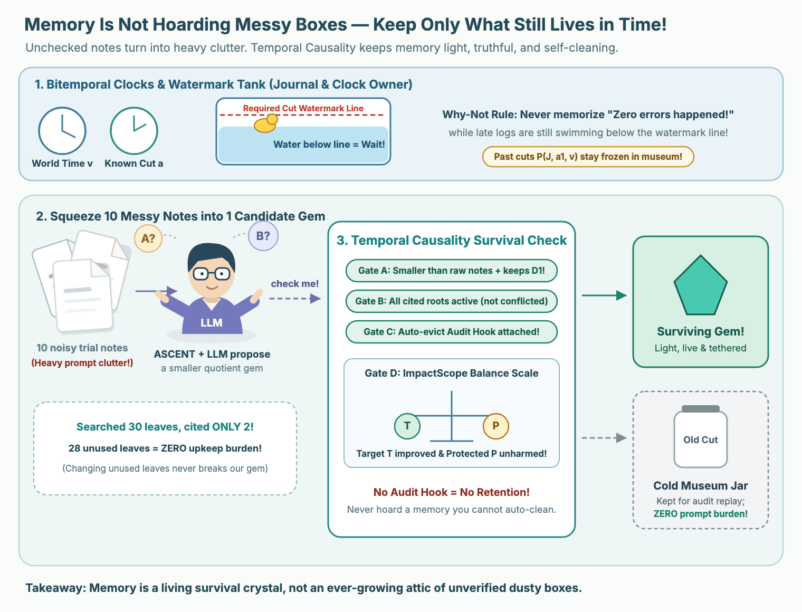

#+title: Temporal Causality as the Causal-Survival Spine for Memory Quotients
#+date: [2026-11-20]
#+language: en
#+property: STATUS design-and-formal-models-verified-no-scheme-changes
#+begin_comment
SPDX-FileCopyrightText: 2026 tao3k team and Contributors
SPDX-License-Identifier: Apache-2.0 AND LGPL-2.1-or-later
#+end_comment

* Why static short-term / long-term memory buckets turn into a burden

Treating Agent Memory as two static containers ("short-term buffer" vs
"long-term store") obscures the actual mathematical problem: raw interaction
traces inject monotonically growing *temporal entropy* (trial-and-error noise,
superseded intermediate hypotheses, unverified summaries and stale premises).
Without continuous validation and audit, retained memory degrades net decision
utility:

#+begin_src typst
$ upright("NetUtility")(M_t | q, sigma_t) =
  I(M_t ; q | sigma_t)
  - lambda_(upright("attn")) H_(upright("noise"))(M_t)
  - lambda_(upright("gov")) upright("AuditDebt")(M_t, sigma_t) $
#+end_src

This slice places [[file:../../../../modules/temporal-causality/framework.org][Temporal Causality]] at the center of the
=ASCENT <-> LLM <-> Temporal Causality= loop so that Memory operates as an
*audited temporal quotient* rather than an ever-growing liability. No Scheme
source files are modified.

* Separation between ASCENT deduction and Temporal Causality survival

Following [[file:../../../../modules/temporal-causality/evidence/model.org][the Temporal Evidence contract]], deductive derivation over a frozen
snapshot is distinct from temporal premise survival:

| Engine | What it owns | What it cannot decide alone |
|--------+--------------+-----------------------------|
| ASCENT (=Why= / =Why-Not=) | Replayable positive atom-rule DAGs and bounded finite-domain nonmembership certificates on one frozen snapshot | Clock-domain comparability, late-arrival watermarks, bitemporal valid-time intervals or cross-cut survival |
| Bounded LLM Proposer | Candidate S-expression/GQL queries, competing causal hypotheses and candidate quotient compressions $m^*$ | Self-validation, watermark completeness, or upgrading time order into identified causation |
| =temporal-causality= | Bitemporal projection $P(J, a, v)$, Allen interval relations + uncertainty, =SourceWatermark=, =EvidenceRetrieval != EvidenceUse != EvidenceAssessment=, LFP invalidation $F_e$, and =ImpactScope= ($T$ vs $P$) | Granting runtime side-effect execution (=actionAuthority = false=) |

* Four survival laws eliminating memory liability

1. *Bitemporal causal survival and strict entropy reduction*: a quotient node
   $m$ remains in the active working slice at $(a_{\mathrm{now}}, v_{\mathrm{target}})$
   only if $\mathrm{Cost}(m) < \mathrm{Cost}(\mathrm{raw})$ (strict entropy
   reduction), active defeaters are preserved, an automatic reverse-dependency
   audit hook is registered (*No Audit Hook, No Retention*), and every cited
   =EvidenceUse= premise evaluates to =active= (neither =retracted=,
   =conflicted=, =uncertain= across an interval boundary, nor =incomparable=
   across clock domains).
2. *Zero invalidation burden from exploratory retrieval*: mutating or retracting
   any item in $\mathrm{Retrieved}(q) \setminus \mathrm{CitedUsed}(m)$ leaves
   $\mathrm{CausallySurvives}(m)$ invariant. Broad search creates zero upkeep
   debt, whereas appending an unreviewed citation after admission immediately
   invalidates prior review.
3. *=SourceWatermark= gates ASCENT =Why-Not= absence memory*: any quotient
   relying on negative absence (e.g., "no rollback alert occurred after deploy")
   requires =SourceWatermark= =coverage-claimed= ($\mathrm{lower} \ge t_{\mathrm{cut}}$);
   lagging or boundary-crossing watermarks block consolidation.
4. *=ImpactScope= gates strategy contrasts*: trajectory contrasts must satisfy
   pre-onset factual-prefix agreement ($t < t_{\mathrm{onset}}$) and invariance
   of protected negative-control metrics $P$, while remaining in
   =descriptiveContrast= or =temporalPossible= modality rather than claiming an
   identified causal law. Evicted or superseded slices rest in the append-only
   cold journal where earlier cuts $P(J, a_1, v)$ remain immutable for audit
   replay with zero active prompt cost.

* Orthogonal SysML v2 Verification Allocation and Local Verification

| Artifact | Disjoint formal ownership under =FormalVerificationTaxonomy= |
|----------+--------------------------------------------------------------|
| [[file:44-temporal-causal-survival-and-memory-quotient.sysml][44-temporal-causal-survival-and-memory-quotient.sysml]] | Bitemporal ports + disjoint allocation to =leanEngine= XOR =quintEngine= (=TemporalSurvivalDispatchAndBoundaryContract=) |
| [[file:44-temporal-causal-survival-and-memory-quotient.lean][44-temporal-causal-survival-and-memory-quotient.lean]] | Unbounded bitemporal journal & citation frame algebra ONLY: =append_later_revision_preserves_historical_cut=, =filterUpToCut_monotone_in_cut=, =unused_retrieved_mutation_creates_zero_invalidation_burden=, =post_admission_citation_invalidates_prior_review=, and =trajectoryImpact_subsumed_by_potentialFrontier= |
| [[file:44-temporal-causal-survival-and-memory-quotient.qnt][44-temporal-causal-survival-and-memory-quotient.qnt]] | Nondeterministic (=nondet=) bitemporal races ONLY: =closeSourceWatermark= vs =admitAscentWhyNotGem=, out-of-order late valid-time retraction advancing live cut without mutating =cut1Snapshot=, and uncited churn vs cited eviction |
| [[file:../../../../dev/d2/governance-illustrations.ts][governance-illustrations.ts]] + [[file:../../../../dev/d2/governance-figures.sysml][governance-figures.sysml]] | OpenSysML + =@deterministic-engineering/render= illustrated view  (=output/44-causal-survival.{svg,png,webp,html,receipt.json}=) |

#+CAPTION: Slice 44 — Bitemporal Causal Survival, SourceWatermark & Memory Quotient

Reproduce all checks locally without touching Scheme sources:

#+begin_src sh
lean docs/10-19-design/10.06-poo-module-system/agentic-ai-context/44-temporal-causal-survival-and-memory-quotient.lean

sysml -strict -no-record-cache \
  docs/10-19-design/10.06-poo-module-system/agentic-ai-context/40-context-governance-boundary.sysml \
  docs/10-19-design/10.06-poo-module-system/agentic-ai-context/44-temporal-causal-survival-and-memory-quotient.sysml \
  -engine run \
  -analysis 'TemporalCausalSurvivalMemoryQuotient::TemporalSurvivalDispatchAndBoundaryContract(true,true,true,true,0)' \
  -analysis 'TemporalCausalSurvivalMemoryQuotient::TemporalSurvivalDispatchAndBoundaryContract(true,true,false,true,1)' \
  -analysis 'TemporalCausalSurvivalMemoryQuotient::TemporalSurvivalDispatchAndBoundaryContract(true,true,true,false,2)'

quint typecheck docs/10-19-design/10.06-poo-module-system/agentic-ai-context/44-temporal-causal-survival-and-memory-quotient.qnt
quint test docs/10-19-design/10.06-poo-module-system/agentic-ai-context/44-temporal-causal-survival-and-memory-quotient.qnt \
  --main TemporalCausalSurvivalMemoryQuotient
quint verify docs/10-19-design/10.06-poo-module-system/agentic-ai-context/44-temporal-causal-survival-and-memory-quotient.qnt \
  --main TemporalCausalSurvivalMemoryQuotient --max-steps 8 --invariant safety

cd dev/d2 && bun run check && bun run governance-figures
#+end_src

Local verification results on 2026-11-20:

- Lean checked all unbounded journal-cut and citation-frame theorems with zero
  errors, warnings or =sorry=.
- Strict SysML validation passed with zero violations; =run= passed guarded
  =mode = 0= and rejected modes =1..2=.
- Quint passed all deterministic runs and symbolic =verify= held =safety= across
  8 =nondet= transitions with =NoError=.
- =@deterministic-engineering/render= + OpenSysML exported =44-causal-survival=
  with =minimumTextSize = 16px= across 39 measured text samples.
