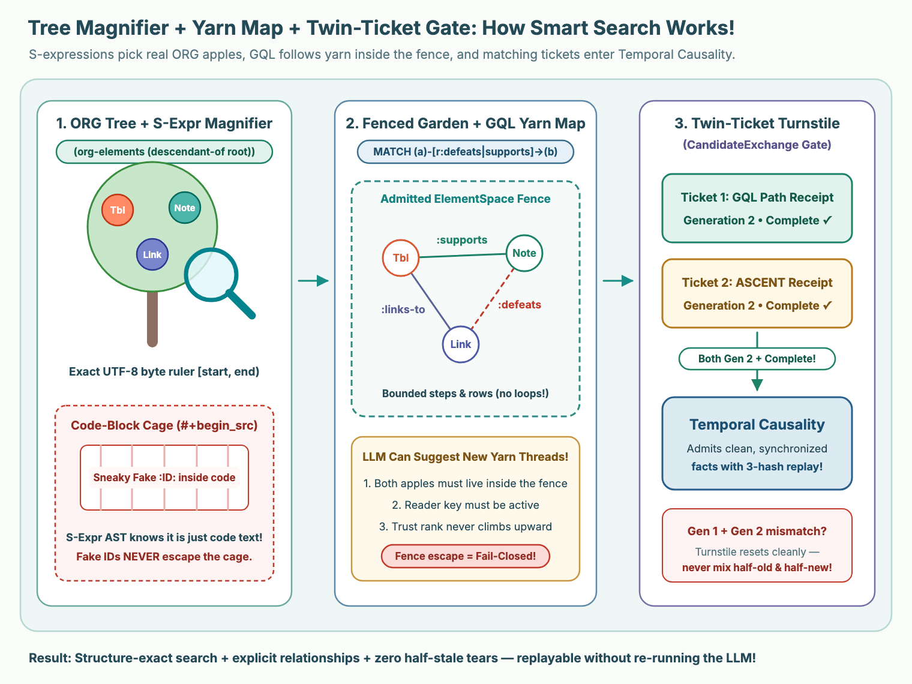

#+title: ORG Element S-Expression Selector, GQL Relationship Search and CandidateExchange
#+date: [2026-11-20]
#+language: en
#+property: STATUS design-and-formal-models-verified-no-scheme-changes
#+begin_comment
SPDX-FileCopyrightText: 2026 tao3k team and Contributors
SPDX-License-Identifier: Apache-2.0 AND LGPL-2.1-or-later
#+end_comment

* Two-tier homoiconic-relational search over ORG knowledge graphs

Vector similarity and flat text chunking discard structural scope, confuse
source-block literals with document properties, and cannot audit multi-hop
relationships. Building on [[file:15-unified-query-provider.org][Slice 15]], [[file:35-org-context-modules.org][Slice 35]] and
[[file:../../../../modules/temporal-causality/evidence/model.org][Temporal CandidateExchange]], this slice formalizes the two-tier search and
relationship-building engine connecting =Orgize=, =POO Query / GQL=, =ASCENT=,
and =Temporal Causality=. No Scheme sources are modified.

* Architecture: Tree Magnifier + Fenced Yarn Graph + Twin-Ticket Gate

| Stage | Semantic owner | Operation and capability | Governance invariant |
|-------+----------------+--------------------------+----------------------|
| 1. AST homoiconic selection | Orgize + =ORG Element= S-expression selector | Composable S-expression combinators select structural AST nodes (headings, drawers, tables, paragraphs, links) with half-open UTF-8 spans $[s, e)$ to populate an admitted =ElementSpace= | Property-looking text inside =source-block= nodes is structurally excluded; spans satisfy $0 \le s \le e \le |\mathrm{bytes}|$ |
| 2. Bounded relational traversal & governed edge nomination | =POO Query / GQL= over =ElementSpace= | =MATCH (a)-[r:supports|defeats|links-to]->(b)= traverses explicit typed edges; LLM-nominated edges enter only as governed candidates | Walks fail closed if any step escapes =ElementSpace= or exceeds fuel/row bounds; nominated edges require admitted endpoints, active read grants and non-escalating trust rank |
| 3. Same-generation multi-provider join | =Temporal Causality= =CandidateExchange= | Joins structural GQL path receipts with deductive ASCENT receipts at the Temporal boundary | Publishes iff every required provider supplies one immutable =complete= receipt at the exact =activeGeneration=; advancing generation atomically clears publication while preserving history |

#+begin_src typst
$ upright("ExchangeEligible")(sigma) equiv
  (sigma "." upright("requiredProviders") != emptyset)
  and forall p in sigma "." upright("requiredProviders"),
    exists r in sigma "." upright("receipts"):
      (r.upright("provider") = p)
      and (r.upright("generation") = sigma "." upright("activeGeneration"))
      and (r.upright("complete") = "#t") $
#+end_src

During symbolic model checking in Quint/Apalache, an unguarded provider retry
within the same generation exposed a 5-step counterexample where a later
incomplete retry overwrote an earlier complete receipt at generation 1 while
leaving =published = true=. Enforcing =ReceiptUniqueness= (at most one immutable
receipt per =(provider, generation)=; retries with altered completeness require
a new generation) discharged that counterexample and matches the upstream
=CandidateExchange= contract.

* Orthogonal SysML v2 Verification Allocation and Local Verification

| Artifact | Disjoint formal ownership under =FormalVerificationTaxonomy= |
|----------+--------------------------------------------------------------|
| [[file:45-org-sexpr-gql-candidate-exchange-search.sysml][45-org-sexpr-gql-candidate-exchange-search.sysml]] | Structural ports across S-expr selector, GQL engine and =CandidateExchange=, plus disjoint allocation to =leanEngine= XOR =quintEngine= (=HybridSearchDispatchAndBoundaryContract=) |
| [[file:45-org-sexpr-gql-candidate-exchange-search.lean][45-org-sexpr-gql-candidate-exchange-search.lean]] | Unbounded recursive AST & multi-hop path induction ONLY: =selectAstTree_excludes_source_blocks= (pruning =sourceBlock= subtrees at any depth), =selectAstTree_preserves_byte_bounds=, =admittedWalk_stays_in_element_space=, and =walkFuel_append= |
| [[file:45-org-sexpr-gql-candidate-exchange-search.qnt][45-org-sexpr-gql-candidate-exchange-search.qnt]] | Nondeterministic (=nondet=) multi-provider concurrency ONLY: asynchronous GQL/ASCENT receipt arrivals, =ReceiptUniqueness= retry collisions, and =advanceTemporalGen= mid-join / post-publication resets |
| [[file:../../../../dev/d2/governance-illustrations.ts][governance-illustrations.ts]] + [[file:../../../../dev/d2/governance-figures.sysml][governance-figures.sysml]] | OpenSysML + =@deterministic-engineering/render= illustrated view  (=output/45-hybrid-search.{svg,png,webp,html,receipt.json}=) |

#+CAPTION: Slice 45 — ORG S-Expression AST Selector, ISO GQL Traversal & CandidateExchange

Reproduce all checks locally without touching Scheme sources:

#+begin_src sh
lean docs/10-19-design/10.06-poo-module-system/agentic-ai-context/45-org-sexpr-gql-candidate-exchange-search.lean

sysml -strict -no-record-cache \
  docs/10-19-design/10.06-poo-module-system/agentic-ai-context/40-context-governance-boundary.sysml \
  docs/10-19-design/10.06-poo-module-system/agentic-ai-context/45-org-sexpr-gql-candidate-exchange-search.sysml \
  -engine run \
  -analysis 'OrgSexprGqlCandidateExchange::HybridSearchDispatchAndBoundaryContract(true,true,true,true,0)' \
  -analysis 'OrgSexprGqlCandidateExchange::HybridSearchDispatchAndBoundaryContract(true,true,false,true,1)' \
  -analysis 'OrgSexprGqlCandidateExchange::HybridSearchDispatchAndBoundaryContract(true,true,true,false,2)'

quint typecheck docs/10-19-design/10.06-poo-module-system/agentic-ai-context/45-org-sexpr-gql-candidate-exchange-search.qnt
quint test docs/10-19-design/10.06-poo-module-system/agentic-ai-context/45-org-sexpr-gql-candidate-exchange-search.qnt \
  --main OrgSexprGqlCandidateExchange
quint verify docs/10-19-design/10.06-poo-module-system/agentic-ai-context/45-org-sexpr-gql-candidate-exchange-search.qnt \
  --main OrgSexprGqlCandidateExchange --max-steps 8 --invariant safety

cd dev/d2 && bun run check && bun run governance-figures
#+end_src

Local verification results on 2026-11-20:

- Lean checked all recursive AST and multi-hop walk theorems with zero errors,
  warnings or =sorry=.
- Strict SysML validation passed with zero violations; =run= passed guarded
  =mode = 0= and rejected modes =1..2=.
- Quint passed all deterministic runs and symbolic =verify= held =safety= across
  8 =nondet= transitions with =NoError=.
- =@deterministic-engineering/render= + OpenSysML exported =45-hybrid-search=
  with =minimumTextSize = 15px= across 41 measured text samples.
