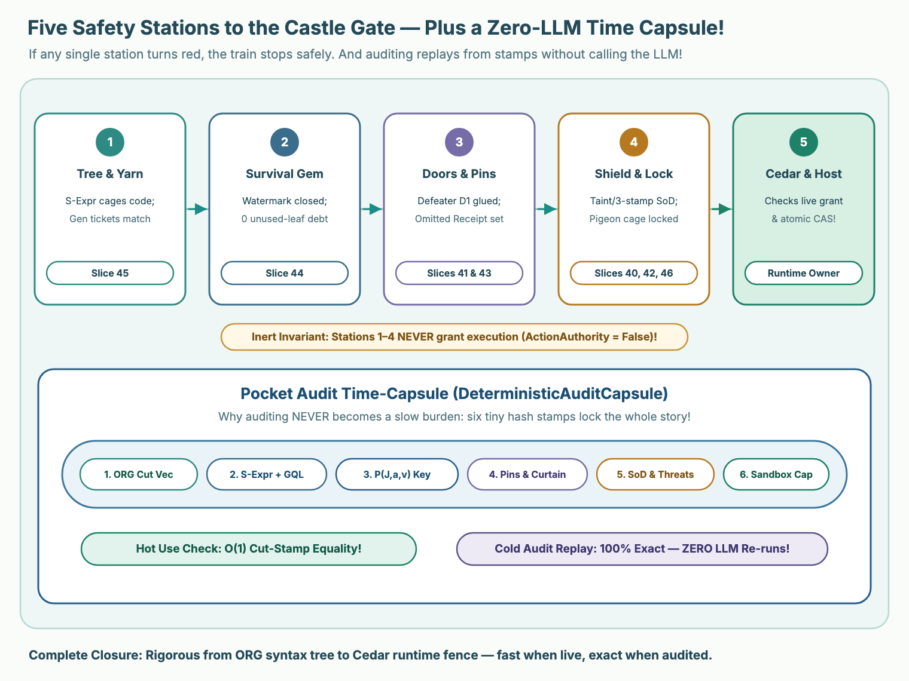

#+title: End-to-End Context System and Governance Assurance Closure
#+date: [2026-11-20]
#+language: en
#+property: STATUS design-and-formal-models-verified-no-scheme-changes
#+begin_comment
SPDX-FileCopyrightText: 2026 tao3k team and Contributors
SPDX-License-Identifier: Apache-2.0 AND LGPL-2.1-or-later
#+end_comment

* Composing Slices 40–46 without turning audit into a runtime burden

Individual safety laws for homoiconic search ([[file:45-org-sexpr-gql-candidate-exchange-search.org][Slice 45]]), bitemporal causal
survival ([[file:44-temporal-causal-survival-and-memory-quotient.org][Slice 44]]), epistemic defeater and branch governance ([[file:41-epistemic-consolidation-governance.org][Slices 41]] and
[[file:43-ascent-security-branch-omission-refinement.org][43]]), taint/declassification Separation of Duties ([[file:40-context-governance-boundary.org][Slices 40]] and [[file:42-multi-repo-multi-agent-declassification.org][42]]), and
Sandbox/Attempt crash fencing ([[file:46-durable-agenda-session-sandbox-governance.org][Slice 46]]) must compose end to end without forcing
live turns to re-run LLM calls or replay full Datalog histories on every read.
This capstone slice closes that composition through a fail-closed five-station
pipeline and a constant-size =DeterministicAuditCapsule=. No Scheme sources are
modified.

* Architecture: Five Safety Stations + Zero-LLM Pocket Audit Time-Capsule

| Pipeline station | Governing slices | Admissibility contract | Runtime cost / audit property |
|------------------+------------------+------------------------+-------------------------------|
| Station 1: Tree & Yarn Search | [[file:45-org-sexpr-gql-candidate-exchange-search.org][Slice 45]] | =ORG Element= S-expr AST selection excludes =source-block= spoofs; GQL stays inside =ElementSpace=; =CandidateExchange= matches generation | Emits =sexprGqlExchangeDigest= over UTF-8 byte spans and relational path receipts |
| Station 2: Temporal Survival Spine | [[file:44-temporal-causal-survival-and-memory-quotient.org][Slice 44]] | Bitemporal $P(J, a, v)$ holds; =SourceWatermark= gates =Why-Not=; unused reads accrue zero invalidation debt; quotient strictly reduces entropy | Emits =bitemporalSurvivalKey=; $O(1)$ cut-vector stamp comparison on hot reads |
| Station 3: Epistemic & Security Branches | [[file:41-epistemic-consolidation-governance.org][Slices 41]] & [[file:43-ascent-security-branch-omission-refinement.org][43]] | Active defeaters pinned; partial hypothesis slices attach =OmittedAlternativesReceipt= blocking destructive actions; 3-way SoD for durable insights | Emits =epistemicProjectionDigest= recording branch $\times$ hypothesis receipts |
| Station 4: Taint, Declassification & Sandbox Lock | [[file:40-context-governance-boundary.org][Slices 40]], [[file:42-multi-repo-multi-agent-declassification.org][42]] & [[file:46-durable-agenda-session-sandbox-governance.org][Slice 46]] | Taint/meet non-escalation, 3-way redacted declassification SoD, KV prefix isolation, Lethal Trifecta exclusion and Attempt crash fencing | Emits =governanceThreatAndSodDigest= + =sandboxCapIntersectionDigest=; zero execution authority |
| Station 5: Independent Cedar & Host Fence | [[file:20-runtime-grant-revocation.org][Slice 20]] & [[file:40-context-governance-boundary.org][Slice 40]] | Independent runtime host checks live Cedar grant, atomic CAS handoff fence and =capsule.boundCut = liveCut= | Cold forensic audit replays 100% deterministically from ORG bytes + journal with **zero LLM calls** |

#+begin_src typst
$ upright("allStagesHold")(x s ++ y s) = (upright("allStagesHold")(x s) and upright("allStagesHold")(y s)),
  quad (c.upright("boundCut") != c_(upright("live"))) => not upright("HotApplicable")(c, c_(upright("live"))) $
#+end_src

* Unbroken 2D Assurance Chain: Horizontal Composition + Vertical Mechanized Gate

Rather than leaving Slices =40=–=47= as parallel files linked only by prose,
this capstone closes *both* dimensions of the formal chain:

| Chain dimension | Mechanized link | Concrete artifact & theorem / gate |
|-----------------+-----------------+------------------------------------|
| Horizontal SysML v2 chain (=40..46,48..53 -> 47=) | =EndToEndContextGovernanceClosure= =private import=s all thirteen upstream packages, embeds their subsystems in the 5 stations, and defines =AuditCapsuleLifecycle= + =QuintTraceScalarReplayContract= | [[file:47-end-to-end-context-governance-assurance-closure.sysml][47-end-to-end-context-governance-assurance-closure.sysml]] |
| Horizontal Lean 4 DAG (=«40»..«46»,«48»..«53» -> 47=) | =47-*.lean= compiles against all thirteen upstream =.olean= modules, composes =selectAstTree= $\rhd$ =stageOneRepair= $\rhd$ =deriveDisclosureDepth= $\rhd$ =filterUpToCut= $\rhd$ =projectGoverned= $\rhd$ =redactFields= $\rhd$ =composeRestrictions= $\rhd$ =noEgressSandbox= plus =PureCAS=/=FencedEffect=, confined-detour/advisory, KV-prefix, fail-closed premise retraction, pinned-GC/sandbox, and C4 profile convergence/veto quotient laws | =pureGovernanceChain_end_to_end_sound=, =leanToQuintBoundaryQuotient_sound=, =replayCapsule_deterministic_without_llm= in [[file:47-end-to-end-context-governance-assurance-closure.lean][47-end-to-end-context-governance-assurance-closure.lean]] |
| Horizontal Quint composition (=s40..s46,s48..s53 -> 47=) | Exhaustive TLC (=queue = 0=) across all thirteen single-plane models + =47-*.qnt= importing =s40..s46,s48..s53= under 8-step Apalache | =hostCasRequiresCurrentCapsuleAndLiveUpstreamPlanes= + =allThirteenUpstreamSliceInvariantsHold= in [[file:47-end-to-end-context-governance-assurance-closure.qnt][47-end-to-end-context-governance-assurance-closure.qnt]] |
| Vertical cross-tool chain runner (v2) | Parses =FormalVerificationTaxonomy= from SysML, enforces 100% bidirectional XOR + zero-orphan =safety= invariants, audits all 97 Lean kernel theorems (=0 sorryAx=), runs 13x TLC + 1x Apalache, exports all 51 real Quint ITF JSON traces and replays them into SysML =QuintTraceScalarReplayContract= alongside 44 dispatch runs and pinned SHA-256 three-way source-binding verification | [[file:run-context-governance-chain.py][run-context-governance-chain.py]] + [[file:40-48-source-bindings-v1.json][40-48-source-bindings-v1.json]] + =just check-context-governance-chain= in [[file:../../../../dev/just/proofs.just][proofs.just]] |
| Independent Lake workspace & CI proof workflow | Standalone Lake package referencing all 14 =.lean= slices without duplicating sources, meta-programmed full-namespace axiom audit across all 14 namespaces, and dedicated GitHub Actions workflow enforcing Lake + OpenSysML + Quint + render readability | [[file:../../../../proofs/ContextGovernance/lakefile.lean][lakefile.lean]] + [[file:../../../../proofs/ContextGovernance/ContextGovernanceAxioms.lean][ContextGovernanceAxioms.lean]] + [[file:../../../../.github/workflows/context-governance-proof.yml][context-governance-proof.yml]] |
| OpenSysML + =@deterministic-engineering/render= illustrated view | End-to-end five-station assurance closure and zero-LLM pocket audit time-capsule |  ([[file:../../../../dev/d2/governance-illustrations.ts][governance-illustrations.ts]]) |

#+CAPTION: Slice 47 — End-to-End 5-Station Governance Assurance Closure & Zero-LLM Audit Capsule

Reproduce the complete 4-stage chain locally in one command without touching
Scheme sources:

#+begin_src sh
# Fast Lake build + full 9-namespace kernel axiom audit:
just check-context-governance-lake

# Fast static SHA-256 anti-drift gate against 40-48-source-bindings-v1.json:
just check-context-governance-bindings

# Complete end-to-end chain (SysML + Lake + Lean + 8x TLC + Apalache + 27 ITF replays + SHA-256 bindings):
just check-context-governance-chain

# Or with explicit external receipt directory and OpenSysML render-receipt check:
python3 docs/10-19-design/10.06-poo-module-system/agentic-ai-context/run-context-governance-chain.py \
  --check-lake --verify-bindings --max-steps 8 --check-renders --artifacts /tmp/ctx-gov-chain

cd dev/d2 && bun run check && bun run governance-figures
#+end_src

Local verification results on 2026-11-23:

- =just check-context-governance-lake= built all 9 slices under
  =proofs/ContextGovernance/= (=leanprover/lean4:v4.36.0=, =-DautoImplicit=false
  -DwarningAsError=true=) and verified =974= declarations across all 9
  namespaces with zero =sorryAx= and zero custom axioms.
- =just check-context-governance-chain= verified all 10 ORG files, 7,068 SysML
  elements and 64,370 checks across 42 packages, 100% bidirectional XOR +
  zero-orphan =safety= mapping across all 32 classified requirements, 54 Lean
  theorems across the compiled =40..46,48 -> 47= =.olean= DAG (=0 sorryAx=, =0=
  custom axioms), 8 exhaustive TLC models (=71,056= distinct states, =queue=0=),
  8-plane composed =47.qnt= under Apalache (=NoError=), 29 SysML dispatch runs,
  27 real Quint ITF JSON scalar trace replays into SysML, and exact SHA-256
  source-binding lockfile agreement against [[file:40-48-source-bindings-v1.json][40-48-source-bindings-v1.json]].
- =@deterministic-engineering/render= + OpenSysML exported all 8 views against
  the full 9-package SysML chain with =minimumTextSize = 15px–16px >= 12px=.
