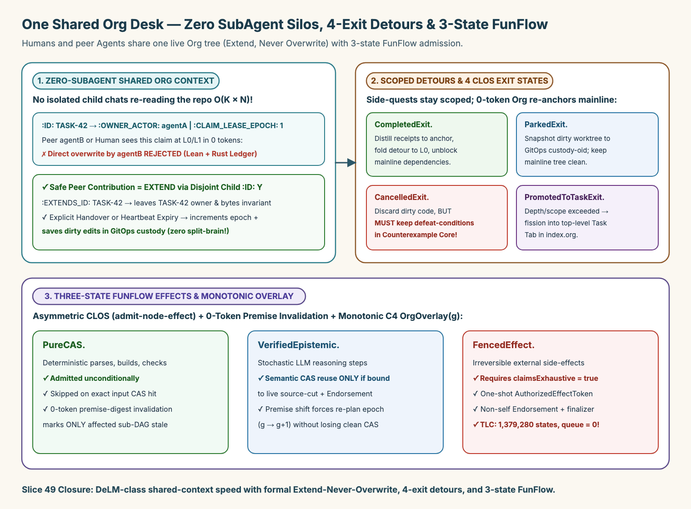

#+title: Scoped Detours, Three-State FunFlow Effects, POO Macro Governance, and Zero-SubAgent Concurrent Shared Context
#+date: [2026-11-24]
#+language: en
#+property: STATUS design-and-formal-models-verified
#+begin_comment
SPDX-FileCopyrightText: 2026 tao3k team and Contributors
SPDX-License-Identifier: Apache-2.0 AND LGPL-2.1-or-later
#+end_comment

* Scope and coupling to Slices 40, 41, 43, 46 and 48

[[file:../../org-elements-gql-context-design.org][Org Elements, ISO GQL, ASCENT Progressive Disclosure, and Durable FunFlow Orchestration]]
unifies five coupled governance and orchestration invariants under one formal
model:

1. *Zero-SubAgent Concurrent Shared Context & Per-=:ID:= Ownership (Extend, Never Overwrite)*:
   There are no isolated "SubAgent" chat silos that re-read the codebase from
   scratch. Sequential or concurrent, Humans and peer Agents operate
   symmetrically over one Shared Org Context where both information and task
   state live directly in Org =:PROPERTIES:= (=:OWNER_ACTOR:=, =:CLAIM_STATE:=,
   =:CLAIM_LEASE_EPOCH:=, =:CLAIM_SCOPE_DIGEST:=, =:CLAIM_WORKTREE:=). When
   actor =A= owns =:ID: X=, peer actor =B != A= immediately perceives that live
   claim at =L0/L1= and must **extend** via a disjoint child/steering node
   =:ID: Y= (=:EXTENDS_ID: X=) rather than overwriting =:ID: X=.
2. *Scoped Detours, 0-Token Org-Elements Re-Anchoring & Four Exit States*:
   Mid-flight side-quests stay inside parent =Task Scope= (=:ROLE: detour=,
   =:DETOUR_KIND: blocker | side-quest=, =:RETURN_ANCHOR: <mainline-id>=). On
   completion or exit, zero-token Org Elements + =ASCENT= re-anchors to
   mainline via four fail-closed CLOS reconcilers (=CompletedExit.=,
   =ParkedExit.= via GitOps custody, =CancelledExit.= preserving
   =defeat-conditions= into Counterexample Core, and =PromotedToTaskExit.=).
3. *Three-State FunFlow Effect Algebra & Premise Invalidation*:
   Nodes classify into =PureCAS.=, =VerifiedEpistemic.=, and =FencedEffect.=;
   irreversible =FencedEffect.= nodes require =claims-exhaustive?: #t= (Slice 43),
   one-shot =AuthorizedEffectToken=, and non-self-endorsing
   =EndorsementReceipt= (Slice 40).
4. *Monotonic =OrgOverlay(g)= C4 Refinement & POO-Constrained Macro Governance*:
   Hot Org overlays validate through =OrgOverlayContract= (never =eval=) and
   narrow =RestrictionEnvelope= monotonically via =restriction-meet=.
5. *Multi-Repo =WorkspaceTopology.= Pin Propagation*:
   Cross-repo Pin propagation runs =PreFlightRemoteDriftProbe= before push
   waves and gates cross-domain context transfers with 3-party SoD
   =DeclassificationCert= (Slice 42).

* Formal Invariants Table

| Mechanism | Semantic owner | Algebraic / concurrency invariant |
|-----------+----------------+-----------------------------------|
| 1. =OrgOverlay(g)= Monotonic Meet | =gerbil-poo= C4 + =RestrictionEnvelope= | $\mathrm{meet}(P, O) \sqsubseteq P$: trust ceiling, lease window, and capabilities never escalate |
| 2. Three-State =FunFlow= Effect Gate | CLOS =admit-node-effect= + Slice 43 | =FencedEffect= admitted iff =claimsExhaustive ∧ hasAuthorizedToken ∧ hasEndorsement=; =PureCAS= admitted unconditionally |
| 3. =CancelledExit.= Counterexample Core | CLOS =reconcile-detour-exit= + Slice 41 | Discarding dirty detour code never drops prior mainline defeaters or newly discovered =defeat-conditions= |
| 4. Zero-Token Mainline Re-Anchor | =orgize= + =ASCENT= =task-reanchor-mainline= | =readyToAutoArchive= is unconditionally =false= while any =blocker= detour or mainline invariant remains open |
| 5. Per-=:ID:= Ownership (Extend-Never-Overwrite) | Shared Org =:PROPERTIES:= + =OrgGovernanceLedger= | Direct write by =B != owner(X)= is rejected; disjoint child extension =Y (Y.id != X.id)= leaves =X='s owner, epoch, and payload invariant |

#+begin_src typst
$ upright("meet")(P, O) <= P, quad
  upright("admit")(upright("FencedEffect"), e, t, r) <=> e and t and r, quad
  B != upright("owner")(X) => upright("write")(B, X) = bot $
#+end_src

* Orthogonal SysML v2 Verification Allocation

| Artifact | Disjoint formal ownership under =FormalVerificationTaxonomy= |
|----------+--------------------------------------------------------------|
| [[file:49-scoped-detour-funflow-concurrent-shared-context.sysml][49-scoped-detour-funflow-concurrent-shared-context.sysml]] | Shared-context ownership, scoped detour 4-exit, and three-state effect ports + disjoint allocation to =leanEngine= XOR =quintEngine= (=ScopedDetourAndConcurrentSharedContextContract=) |
| [[file:49-scoped-detour-funflow-concurrent-shared-context.lean][49-scoped-detour-funflow-concurrent-shared-context.lean]] | Unbounded algebraic & structural preservation laws ONLY: =orgOverlayMeet_no_trust_escalation=, =orgOverlayMeet_lease_contained=, =orgOverlayMeet_capabilities_monotonic=, =fencedEffect_requires_exhaustive_token_and_endorsement=, =pureCAS_admitted_without_exhaustiveness=, =cancelledDetour_preserves_mainline_and_new_defeaters=, =reanchorMainline_blocks_archive_if_blocker_or_invariant_open=, =directWrite_nonOwner_rejected=, =extendChild_preserves_claimed_node_invariant=, =activeLeaseTakeover_rejected_before_expiry=, and =expiredLeaseTakeover_strictly_advances_epoch= |
| [[file:49-scoped-detour-funflow-concurrent-shared-context.qnt][49-scoped-detour-funflow-concurrent-shared-context.qnt]] | Nondeterministic concurrent peer-actor & detour interleavings ONLY: Human + peer Agents racing over shared =:ID:= claims, child extensions, fenced custody handovers, detour completion/parking/cancellation, premise-cut invalidation, and negative-control fault injection |
| [[file:../../../../dev/d2/governance-illustrations.ts][governance-illustrations.ts]] + [[file:../../../../dev/d2/governance-figures.sysml][governance-figures.sysml]] | OpenSysML + =@deterministic-engineering/render= illustrated view  (=output/49-shared-context-detours.{svg,png,webp,html,receipt.json}=) |

#+CAPTION: Slice 49 — Zero-SubAgent Shared Context, Scoped Detours & Three-State FunFlow Effects

