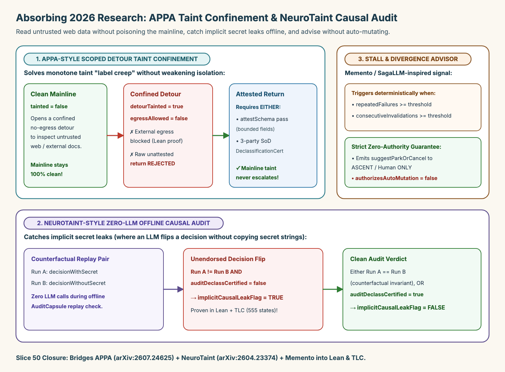

#+title: 2025-2026 Literature Positioning, Scoped Detour Taint Confinement, and Offline Causal Audit
#+date: [2026-11-24]
#+language: en
#+property: STATUS design-and-formal-models-verified-no-scheme-changes
#+begin_comment
SPDX-FileCopyrightText: 2026 tao3k team and Contributors
SPDX-License-Identifier: Apache-2.0 AND LGPL-2.1-or-later
#+end_comment

* Scope: Credit Before Comparison Across the 2025–2026 Agentic Context Frontier

[[file:10-scroll-carryon-clm-contract-comparison.org][Slice 10]] previously established our primary-source comparison against Scroll,
CarryOn, and CLM. Since then, both community research (2025–2026) and
=agentic-ai-lab= ([[file:40-context-governance-boundary.org][Slices 40]]–[[file:49-scoped-detour-funflow-concurrent-shared-context.org][49]] plus [[file:../../org-elements-gql-context-design.org][Org Elements, GQL, and Durable FunFlow]])
have advanced sharply along five convergent axes. This slice (1) credits and
benchmarks primary 2025–2026 papers against our implemented Context and
Orchestrator architecture, and (2) formally absorbs three high-leverage
mechanisms from that literature into our orthogonal SysML v2 / Lean 4 / Quint
assurance chain. No Scheme files are modified.

* Primary-Source Literature Comparison Matrix (2025–2026)

| Pillar | Primary-source papers | Core community mechanism & reported result | Current =agentic-ai-lab= position (Slices 40–49) | Delta / Gap absorbed in Slice 50 |
|--------+-----------------------+--------------------------------------------+---------------------------------------------------+----------------------------------|
| 1. Shared Context vs Isolated SubAgents | *DeLM* (Mao & Mirhoseini, Stanford, =arXiv:2606.10662=, 2026); *Blackboard MAS* (Han & Zhang, =arXiv:2507.01701=, 2025) | Replaces central SubAgent loops with a global task queue, shared verified context, and unfoldable memory; improves SWE-bench Verified by +10.5 to +17.5 pp while cutting cost ~50% and running up to 2.49x faster by eliminating synchronization bubbles. Warns of blackboard memory poisoning. | [[file:49-scoped-detour-funflow-concurrent-shared-context.org][Slice 49]] eliminates SubAgent silos symmetrically across Humans & peer Agents via Org =:PROPERTIES:= =:ID:= leases, =Extend-Never-Overwrite=, =OrgGovernanceLedger=, and =funs-subtree-mediation=. | Already exceeds unstructured blackboards structurally; Slice 50 adds explicit causal-provenance audit over shared =:ID:= reads. |
| 2. Trajectory Branching, Folding & Transactional Rollback | *Context-Folding / FoldGRPO* (Sun et al., =arXiv:2510.11967=, Oct 2025); *AgentFold* (Ye et al., Oct 2025); *Memento* (2026); *SagaLLM* (Chang & Geng, Mar 2025) | *FoldGRPO* spawns procedural =branch= / =return= sub-trajectories trained via RL (10x smaller active context: 32K vs 327K+, 62.0% BrowseComp-Plus, 58.0% SWE-Bench Verified); *AgentFold* folds 100 turns to ~7K tokens; *Memento* adds confidence backtracking; *SagaLLM* adds compensating transactions. | [[file:48-progressive-disclosure-and-two-stage-org-repair.org][Slice 48]] & [[file:49-scoped-detour-funflow-concurrent-shared-context.org][Slice 49]] use 0-token Org Elements + ASCENT dual-focus disclosure (no lossy LLM summarization) and 4 fail-closed CLOS detour exits (=CompletedExit.=, =ParkedExit.=, =CancelledExit.= preserving =defeat-conditions=, =PromotedToTaskExit.=). | Absorbs deterministic stall & repeated-failure advisory signals (*Mechanism 3*) to propose Park/Cancel to ASCENT/Human without auto-mutating state. |
| 3. Information-Flow Control (IFC), Recoverable Taint & External Interceptors | *FIDES* (MSR, =arXiv:2505.23643=, 2025); *APPA* (=arXiv:2607.24625=, Jul 2026); *NeuroTaint* (Cai et al., =arXiv:2604.23374=, Apr 2026); *FLOWSEAL* (=arXiv:2609.14003=, Sep 2026); *MindGuard* (=arXiv:2508.20412=, 2025) | *FLOWSEAL* places an external tool-level IFC interceptor outside the LLM (dropping Workspace Lure leaks from 52.2% to 0.5%). *APPA* solves monotone taint *label creep* via on-demand trajectory confinement + =attest-schema= return channels (proved in a two-monoid model). *NeuroTaint* tracks semantic paraphrasing & *implicit causal decision influence* offline (*TaintBench*, 400 scenarios). | [[file:40-context-governance-boundary.org][Slice 40]], [[file:42-multi-repo-multi-agent-declassification.org][42]], and [[file:46-durable-agenda-session-sandbox-governance.org][46]] enforce independent Cedar/Host fences, 3-party SoD =DeclassificationCert=, monotonic =restriction-meet=, and Lethal Trifecta exclusion. | Absorbs APPA *Scoped Detour Taint Confinement* (*Mechanism 1*) to prevent mainline label creep, and NeuroTaint *Offline Causal Counterfactual Audit* (*Mechanism 2*). |
| 4. DAG Reasoning Cache & Premise Invalidation | *SemanticALLI* (=arXiv:2601.16286=, Jan 2026); *AssetOpsBench* temporal semantic caching (2025–2026) | Replaces monolithic prompt caching (~38.7% hit cap) with DAG node-level structured IR memoization (AIR / VS) and dependency-aware invalidation against state drift / phantom hits. | [[file:44-temporal-causal-survival-and-memory-quotient.org][Slice 44]] & [[file:49-scoped-detour-funflow-concurrent-shared-context.org][Slice 49]] implement three-state =FunFlow= (=PureCAS.= / =VerifiedEpistemic.= bound to live =source-cut= + =EndorsementReceipt= / =FencedEffect.=) with 0-token =premise-digests= + =assumption_invalidated=. | Already establishes stronger cryptographic cut-binding and non-cacheable side-effect boundaries than similarity-threshold caches. |
| 5. Bitemporal Memory & 4-Layer Progressive Disclosure | *Context Engineering Survey* (=arXiv:2507.13334=, 2025); *APDMem* (=arXiv:2610.02472=, Oct 2026); *Zep / Graphiti* (2025); *ReCAP* (2025–2026); *PRECOG* (=arXiv:2509.20645=, 2025) | *APDMem* structures memory into =L0..L3= progressive disclosure (~8% history read on LongMemEval); *Zep/Graphiti* tracks bitemporal valid/transaction time; *ReCAP* restores context via lightweight graphs without re-running LLMs. | [[file:44-temporal-causal-survival-and-memory-quotient.org][Slice 44]] + [[file:48-progressive-disclosure-and-two-stage-org-repair.org][Slice 48]] preserve immutable source bytes, enforce =SourceWatermark= for =Why-Not=, pin mandatory =L3= floor on active defeaters, and prove all laws in Lean 4 / Quint. | Confirms our non-compression, 0-token =L0..L3= + bitemporal route as aligned with and stricter than empirical benchmarks. |

* Three Absorbed Mechanisms Formalized in Slice 50

1. **Mechanism 1 — APPA-Inspired Scoped Detour Taint Confinement (Recoverable IFC without Label Creep)**:
   - Reading untrusted external sources (web pages, unvetted tool outputs) occurs
     inside a confined =no-egress= =Scoped Detour= (=detourTainted = true= while
     =mainlineTainted= stays invariant).
   - While confined and tainted, egress is unconditionally forbidden (preserving
     Slice 46 Lethal-Trifecta exclusion).
   - Merging back to =:RETURN_ANCHOR:= is admitted *only* when the return payload
     passes a shape-bounded =attestSchema= validator *or* carries a valid 3-party
     =DeclassificationCert= (Slice 42). Unattested raw payloads fail closed,
     while valid bounded-schema returns preserve the mainline's clean taint label.
2. **Mechanism 2 — NeuroTaint-Inspired Zero-LLM Offline Causal Counterfactual Audit**:
   - Syntax/label tracking catches direct secret copies, but an LLM can still
     leak sensitive context implicitly by flipping a tool-choice or branch
     decision after reading a secret =:ID:=.
   - Extending =DeterministicAuditCapsule= (Slice 47), the offline auditor
     evaluates pure counterfactual invariance: if removing an unendorsed
     sensitive input flips the observed downstream branch decision without a
     =DeclassificationCert=, the audit deterministically raises
     =implicitCausalLeakFlag = true= with zero LLM calls.
3. **Mechanism 3 — Deterministic Stall & Divergence Advisory Trigger (Zero Auto-Mutation)**:
   - Inspired by *Memento* confidence backtracking and *SagaLLM* failure recovery,
     repeated identical failure signatures or consecutive premise-cut
     invalidations at or above a configured threshold deterministically emit a
     =suggestParkOrCancel= advisory to ASCENT / Human.
   - Strictly obeying our Governance boundary, an advisory signal **never**
     grants execution authority, **never** auto-mutates mainline Org state, and
     **never** drops accumulated =defeat-conditions=.

#+begin_src typst
$ upright("mergeConfined")(m, d) = upright("ok") => (upright("schemaAttested")(d) or upright("declassCert")(d)) and m'.upright("taint") = m.upright("taint") $
#+end_src

* Orthogonal SysML v2 Verification Allocation

| Artifact | Disjoint formal ownership under =FormalVerificationTaxonomy= |
|----------+--------------------------------------------------------------|
| [[file:50-literature-frontier-detour-confinement-and-causal-audit.sysml][50-literature-frontier-detour-confinement-and-causal-audit.sysml]] | Confined-detour taint isolation, offline causal audit, and stall advisory ports + strict XOR allocation to =leanEngine= vs =quintEngine= (=LiteratureAbsorptionDispatchAndBoundaryContract=) |
| [[file:50-literature-frontier-detour-confinement-and-causal-audit.lean][50-literature-frontier-detour-confinement-and-causal-audit.lean]] | Unbounded algebraic & preservation laws ONLY: =confinedDetour_isolates_untrusted_read_from_mainline=, =confinedDetour_no_egress_when_tainted=, =unattestedDetourReturn_rejected=, =attestedDetourReturn_preserves_mainline_taint_without_label_creep=, =causalAudit_flags_unendorsed_branch_flip=, =causalAudit_clean_when_counterfactual_invariant=, =causalAudit_clean_when_declassification_certified=, =advisoryTrigger_fires_on_stall_threshold=, =advisoryTrigger_never_authorizes_auto_mutation= |
| [[file:50-literature-frontier-detour-confinement-and-causal-audit.qnt][50-literature-frontier-detour-confinement-and-causal-audit.qnt]] | Nondeterministic concurrent detour confinement, untrusted-read, schema-attestation, causal-flip audit, and stall-advisory races ONLY (exhaustive TLC =queue = 0= + negative-control counterexamples) |
| [[file:../../../../dev/d2/governance-illustrations.ts][governance-illustrations.ts]] + [[file:../../../../dev/d2/governance-figures.sysml][governance-figures.sysml]] | OpenSysML + =@deterministic-engineering/render= illustrated view  (=output/50-detour-confinement-audit.{svg,png,webp,html,receipt.json}=) |

#+CAPTION: Slice 50 — APPA Confined Detour Taint Isolation, NeuroTaint Causal Audit & Stall Advisory

