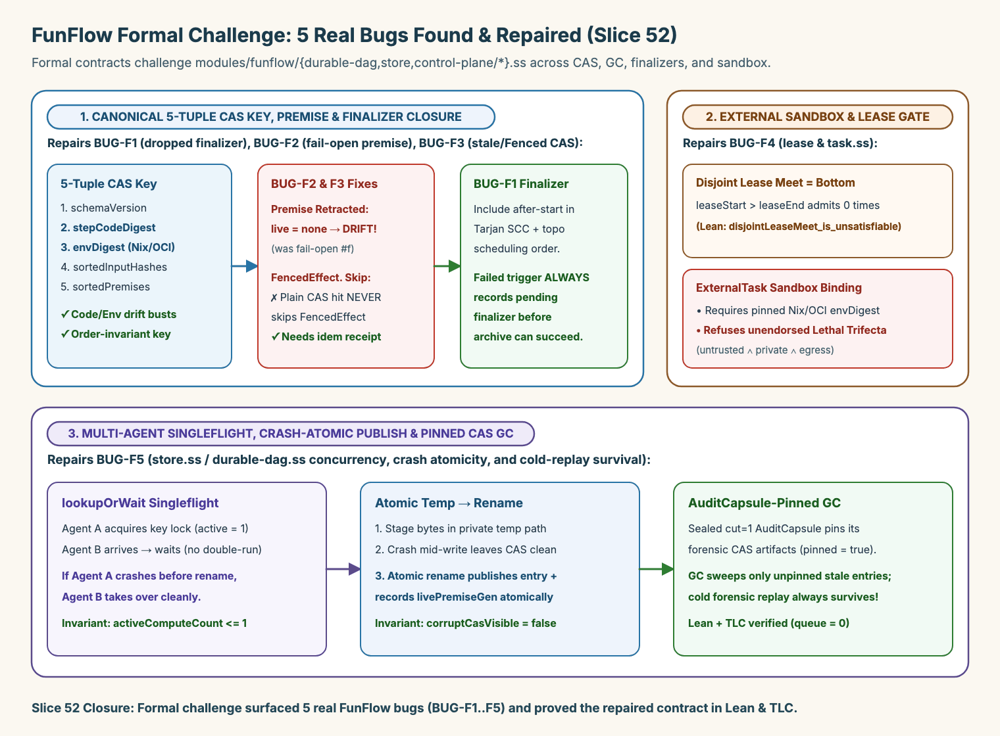

#+TITLE: 52: FunFlow CAS Singleflight, Fail-Closed Premise Invalidation, Finalizer Closure, and External Sandbox Binding
#+AUTHOR: tao3k team and Contributors
#+DATE: 2026-11-24
# SPDX-FileCopyrightText: 2026 tao3k team and Contributors
# SPDX-License-Identifier: Apache-2.0 AND LGPL-2.1-or-later

* Purpose: Challenging the Real FunFlow Design Through Formal Contracts

Formal contracts in this repository are not post-hoc rubber stamps for code we
already assume is correct. Their primary engineering purpose is to *challenge
the real program design*, uncover logical flaws and race windows in the
existing implementation, and force concrete structural repairs before runtime
adoption.

Auditing =modules/funflow/durable-dag.ss=, =modules/funflow/store.ss=, and
=modules/funflow/control-plane/{flow,task,runner}.ss= against Tweag =funflow='s
content-addressed workflow semantics and Slices =40=–=51= uncovered *five
concrete logical bugs and architectural gaps* (=BUG-F1= through =BUG-F5=).
Slice =52= formalizes every one of these five boundaries across SysML v2,
Lean 4, and Quint (TLC), with explicit negative-control counterexamples that
reproduce each bug and prove why the repaired contract closes it.

* Five Concrete Design Flaws Uncovered by Formal Challenge

| Bug ID | Exact Source Location | Observed Logical Flaw in Current Design | Repaired Formal Contract in Slice 52 |
|--------+-----------------------+-----------------------------------------+--------------------------------------|
| =BUG-F1= | =modules/funflow/durable-dag.ss= (=topological-order= L481–507, =find-cycle-nodes= L433–474, =funflow-resume-plan= L639–642) | =dep-map= tracks only =needs= and omits =after-start=. A finalizer node listed earlier than its trigger appears *before* the trigger in =topological-order=, so =(hash-key? failed-set fin-trigger)= evaluates to =#f= during the single pass and silently drops the finalizer from =pending-finalizers=. Likewise, =after-start= cycles escape Tarjan SCC. | Include =after-start= edges in both cycle detection and topological/two-pass scheduling; archive guards fail closed whenever any failed trigger has an unsettled finalizer. |
| =BUG-F2= | =modules/funflow/durable-dag.ss= (=funflow-invalidate-premises= L746–755) | Line 754 checks =(and live (not (equal? (cdr live) expected)))=. When a cited premise is *retracted or deleted* from =live-premise-alist= (=live = #f=), the predicate evaluates to =#f= (*fail-open*), leaving dependent nodes silently in =unaffected-nodes=! | Fail-closed premise drift: =(or (not live) (not (equal? (cdr live) expected)))=. Proven in Lean (=retractedPremise_always_invalidates_fail_closed= vs =buggyFailOpen_misses_retracted_premise=). |
| =BUG-F3= | =modules/funflow/durable-dag.ss= (=canonical-sha256= L60–66, =funflow-cas-fingerprint= L295–319, =cas-hit?= L594–605, =funflow-resume-plan= L648–650) | (a) =funflow-cas-fingerprint= omits =step-code-digest= and =env-digest= (Nix/Docker/Sandbox image digest), producing phantom stale CAS hits after code or toolchain upgrades. (b) =canonical-sha256= hashes raw =(write payload port)= and includes node label =id=. (c) =cas-hit?= never checks =effect-class=, allowing =FencedEffect.= or unendorsed =VerifiedEpistemic.= nodes to be skipped by a plain CAS fingerprint hit! | Canonical 5-tuple CAS key (=schemaVersion=, =stepCodeDigest=, =envDigest=, canonically sorted =inputHashes=, canonically sorted =premiseDigests=). =cas-hit?= is strictly gated by =EffectClass=: =PureCAS.= allows pure CAS skip, =VerifiedEpistemic.= requires live premise generation + endorsement, and =FencedEffect.= NEVER reuses a plain CAS hit without an authoritative idempotency commit receipt. |
| =BUG-F4= | =modules/funflow/durable-dag.ss= (=funflow-envelope-meet= L218–219) and =modules/funflow/control-plane/task.ss= (=make-external-task= L360) | (a) =funflow-envelope-meet= computes =(max p-start o-start)= and =(min p-end o-end)= without flagging inverted empty intervals (=lease-start > lease-end=), and =admit-node-effect= never checks lease satisfaction. (b) =make-external-task= carries no =env-digest= and no Slice =46= Lethal-Trifecta / Slice =50= =no-egress= sandbox binding. | Disjoint lease meet is proven unsatisfiable for every timestamp (=disjointLeaseMeet_is_unsatisfiable=). Every =ExternalTask= requires a pinned =envDigest= and fails closed under Lethal-Trifecta (=untrustedInput ∧ privateData ∧ egressEnabled ∧ ¬egressEndorsed=). |
| =BUG-F5= | =modules/funflow/store.ss= + =modules/funflow/durable-dag.ss= + =modules/funflow/control-plane/runner.ss= | (a) No multi-agent concurrent =lookupOrWait= singleflight lock (two sessions miss CAS concurrently and double-compute, or race on =FencedEffect=). (b) No atomic temp-write-then-rename publication barrier (crash mid-write can expose corrupt/partial CAS artifacts). (c) No =AuditCapsule=-pinned CAS GC guard (unpinned GC can delete historical =cut = 1= forensic artifacts required by Capstone =47='s zero-LLM cold replay). (d) =control-plane/flow.ss= and =durable-dag.ss= operate as two disconnected worlds. | Singleflight =lookupOrWait= ensures at most 1 active compute per uncached key; crash before atomic rename leaves CAS clean and wakes waiters; GC strictly preserves =capsulePinned= entries; pure =flow->durable-dag= compiler lowers declarative flows onto the governed DAG engine. |

* Orthogonal Verification Split (=FormalVerificationTaxonomy=)

In [[file:52-funflow-cas-singleflight-and-external-sandbox-binding.sysml][52-funflow-cas-singleflight-and-external-sandbox-binding.sysml]], all
obligations obey the strict XOR dispatch rule from [[file:40-context-governance-boundary.sysml][Slice 40]]:

- *Lean 4 Unbounded Algebraic & Structural Obligations* ([[file:52-funflow-cas-singleflight-and-external-sandbox-binding.lean][52-*.lean]]):
  1. =canonicalCasKeyAndFailClosedPremiseLaw=:
     - =casKey_sensitive_to_code_and_env_drift= — drifting =stepCodeDigest= or
       =envDigest= strictly alters the canonical 5-tuple CAS key (=BUG-F3=).
     - =casKey_input_order_invariant= — canonical sorting makes the CAS key
       invariant to distinct input arrival order (=BUG-F3=).
     - =retractedPremise_always_invalidates_fail_closed= — missing/retracted
       premises always trigger invalidation, contrasted against
       =buggyFailOpen_misses_retracted_premise= (=BUG-F2=).
     - =fencedEffect_never_reused_by_plain_cas= — plain CAS hits without an
       idempotency commit receipt can never settle a =FencedEffect.= (=BUG-F3=).
  2. =capsulePinnedGcAndExternalSandboxLaw=:
     - =gc_never_evicts_capsule_pinned_entry= — CAS GC sweeps preserve every
       =AuditCapsule=-pinned entry over arbitrary lists (=BUG-F5=).
     - =disjointLeaseMeet_is_unsatisfiable= — meeting disjoint lease intervals
       admits zero timestamps (=BUG-F4=).
     - =externalTask_rejects_unpinned_or_trifecta_sandbox= — unpinned
       environment digests or unendorsed Lethal-Trifecta profiles are
       universally refused (=BUG-F4=).
- *Quint Nondeterministic Concurrent Interleaving Obligations* ([[file:52-funflow-cas-singleflight-and-external-sandbox-binding.qnt][52-*.qnt]]):
  1. =singleflightAtomicPublishGcAndFinalizerRace=:
     - =singleflightAtMostOneActiveComputePerKey= — concurrent Agent A / Agent
       B =lookupOrWait= runs at most one computation per key (=BUG-F5=).
     - =atomicPublishNeverExposesPartialEntryOnCrash= — crashing between temp
       staging and atomic rename never exposes a corrupt CAS entry (=BUG-F5=).
     - =gcNeverEvictsCapsulePinnedForensicEntry= — concurrent GC sweeps never
       evict an =AuditCapsule=-pinned historical artifact (=BUG-F5=).
     - =fencedEffectExecutesAtMostOnceAndFinalizerNeverDropped= — =FencedEffect=
       executes at most once, and a failed trigger cannot be archived while its
       =after-start= finalizer remains pending (=BUG-F1= & =BUG-F3=).
  2. Four standalone =buggy*= fault-injection counterexample runs reproduce
     singleflight bypass, non-atomic crash corruption, unpinned GC forensic
     loss, and misordered finalizer drop / double =FencedEffect= execution,
     exporting real ITF JSON traces replayed into SysML
     =QuintTraceScalarReplayContract=.

* Downstream Engineering Convergence Contract (Wave 3 Targets)

When Wave 3 patches =modules/funflow/=, every code change must discharge its
corresponding Slice =52= obligation with focused POO/Gerbil tests run via
=just test-file=:

1. Patch =modules/funflow/durable-dag.ss=:
   - Fix =BUG-F1=: add =after-start= edges into =find-cycle-nodes= and
     =topological-order= (or run two-pass failed-set collection before
     finalizer scheduling).
   - Fix =BUG-F2=: change =funflow-invalidate-premises= line 754 to fail closed
     when =live= is =#f=.
   - Fix =BUG-F3=: introduce canonical 5-tuple encoder + =step-code-digest= and
     =env-digest= slots on =FunflowNode.=, and gate =cas-hit?= strictly by
     =EffectClass= (=PureCAS.= vs =VerifiedEpistemic.= vs =FencedEffect.=).
   - Fix =BUG-F4=: add =lease-valid?: (<= next-start next-end)= to
     =funflow-envelope-meet= and enforce lease + Lethal-Trifecta checks in
     =admit-node-effect=.
2. Bridge =modules/funflow/control-plane/{flow,task,runner}.ss= and
   =modules/funflow/store.ss=:
   - Fix =BUG-F5=: add pure =flow->durable-dag= compiler, atomic
     temp-write-then-rename CAS store with concurrent =lookup-or-wait=
     singleflight and =AuditCapsule=-pinned GC, and bind =ExternalTask= to
     =modules/nono-sandbox= / =modules/docker= / Nix =env-digest=.

* Capstone Composition

[[file:47-end-to-end-context-governance-assurance-closure.org][Slice 47]]
imports =FunflowCasSingleflightAndExternalSandbox= as the twelfth upstream
plane (=40..46, 48..52 -> 47=), ensuring live Host CAS admission fails closed
if CAS corruption, pinned-GC eviction, or finalizer drop occurs, while cold
forensic replay at =cut = 1= remains intact.

* Illustrated Architecture View

Rendered via OpenSysML + =@deterministic-engineering/render= ([[file:../../../../dev/d2/governance-illustrations.ts][governance-illustrations.ts]] + [[file:../../../../dev/d2/governance-figures.sysml][governance-figures.sysml]]):

#+CAPTION: Slice 52 — FunFlow Formal Challenge: 5 Real Bugs Found & Repaired (CAS, Singleflight, Pinned GC & External Sandbox)

