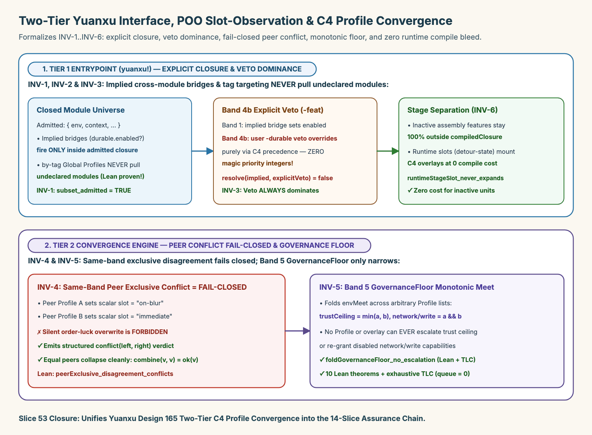

# SPDX-FileCopyrightText: 2026 tao3k team and Contributors
# SPDX-License-Identifier: Apache-2.0 AND LGPL-2.1-or-later

#+title: Slice 53: Two-Tier Yuanxu Interface, POO Slot-Observation, and C4 Profile Convergence
#+date: [2026-11-24]

* Scope

Formalizes and machine-checks the six engineering invariants (=INV-1..INV-6=) of
Yuanxu Design 165 (=core/module-system/design/165-two-tier-yuanxu-interface-c4-conditional-mixins-and-specialisations.org=):

1. *INV-1 (Explicit Closure Conservation)*: Implied cross-module bridges
   (=enabled?: durable.enabled?=) and =by-tag= Global Profile targeting never
   pull an undeclared module into =module-closure=.
2. *INV-2 (Bounded Monotone Fixpoint)*: Assembly-stage slot observation
   activation is monotone and closure-preserving over the explicitly admitted
   module universe.
3. *INV-3 (Explicit Veto Dominance)*: Band 4b explicit =-feature= override
   (=enabled?: #f=) strictly dominates Band 1 implied activation via pure C4.
4. *INV-4 (Same-Band Peer Conflict Fail-Closed)*: Two peer Profiles or features
   in the same C4 band disagreeing on an =exclusive= scalar slot fail closed
   with a structured conflict verdict (never silent order luck).
5. *INV-5 (Monotonic Governance Floor)*: Band 5 =GovernanceFloor= =meet= over
   arbitrary Profile lists never escalates trust ceiling or capabilities.
6. *INV-6 (Stage Separation / Zero Cost for Inactive Units)*: Inactive features
   never enter the compiled/loaded closure, and ='runtime=-stage slots (e.g.,
   =durable.detour-state=) never expand ='assembly=-stage compilation closures.

* Artifacts

- OpenSysML v2: [[file:53-yuanxu-c4-profile-convergence-and-interface-slots.sysml][53-yuanxu-c4-profile-convergence-and-interface-slots.sysml]]
- Lean 4: [[file:53-yuanxu-c4-profile-convergence-and-interface-slots.lean][53-yuanxu-c4-profile-convergence-and-interface-slots.lean]]
- Quint: [[file:53-yuanxu-c4-profile-convergence-and-interface-slots.qnt][53-yuanxu-c4-profile-convergence-and-interface-slots.qnt]]
- Illustrated View ([[file:../../../../dev/d2/governance-illustrations.ts][governance-illustrations.ts]] + [[file:../../../../dev/d2/governance-figures.sysml][governance-figures.sysml]]): 

#+CAPTION: Slice 53 — Two-Tier Yuanxu Interface, POO Slot-Observation & C4 Profile Convergence

