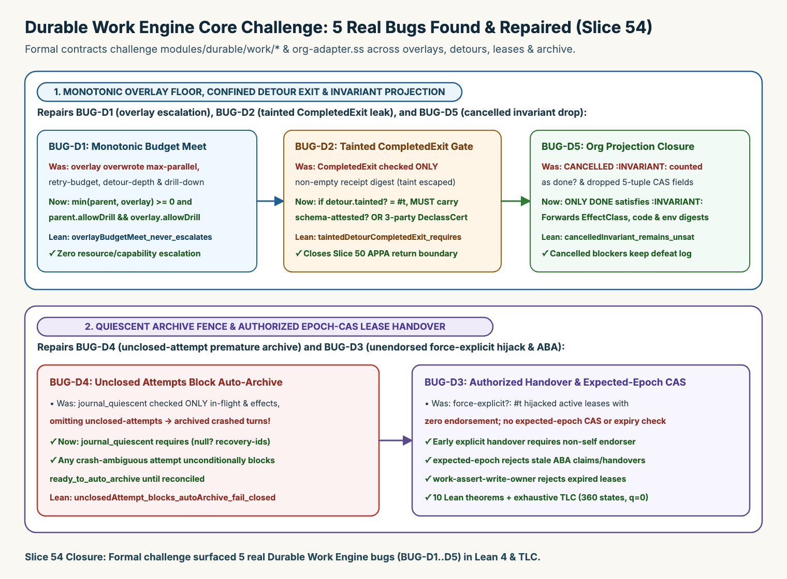

#+TITLE: 54: Pure Durable Work Engine Core Formal Challenge — Monotonic Overlays, Confined Detour Exit, Quiescent Archive & Authorized Handover
#+AUTHOR: tao3k team and Contributors
#+DATE: 2026-11-24
# SPDX-FileCopyrightText: 2026 tao3k team and Contributors
# SPDX-License-Identifier: Apache-2.0 AND LGPL-2.1-or-later

* Purpose: Challenging the Pure Durable Work Engine Core Through Formal Contracts

Following Slice =52='s formal challenge of =modules/funflow/=, Slice =54=
challenges the freshly extracted pure Durable Work Engine Core
(=modules/durable/work/{contracts,detour-engine,claims-engine,scheduler}.ss=)
and its thin Org adapter
(=modules/ai-agentic-context/features/durable/org-adapter.ss=).

Auditing those five Scheme source files against Slices =46=, =49=, =50=, =52=,
and =53= uncovered *five concrete logical bugs* (=BUG-D1= through =BUG-D5=).
Slice =54= formalizes every one of them across SysML v2, Lean 4, and Quint
(exhaustive TLC), with negative-control counterexamples proving how each bug
breaks safety and why the repaired contract closes it.

* Five Concrete Design Flaws Uncovered by Formal Challenge

| Bug ID | Exact Source Location | Observed Logical Flaw in Current Implementation | Repaired Formal Contract in Slice 54 |
|--------+-----------------------+-------------------------------------------------+--------------------------------------|
| =BUG-D1= | =modules/durable/work/detour-engine.ss= (=work-apply-overlay= L178–180) and =modules/durable/work/scheduler.ss= (=default-work-effective-rules= L48) | =work-apply-overlay= overwrites =max-concurrency=, =retry-budget=, and =max-detour-depth= directly from the overlay instead of taking monotonic =min=; =default-work-effective-rules= overwrites =allow-agent-drill-down= instead of monotonic =and=. A hot overlay can escalate parent resource/drill-down budgets. | Monotonic floor meet: =min(parent, overlay)= clamped >= 0 for numeric budgets, and =parent ∧ overlay= for =allow-agent-drill-down= (proven in Lean: =overlayBudgetMeet_never_escalates= vs =buggyOverwriteOverlay_escalates_concurrency=). |
| =BUG-D2= | =modules/durable/work/detour-engine.ss= (=DetourExitMethods= on =CompletedExit.= L85–103) | =CompletedExit.= checks only that =outcome-receipt-digest= is non-empty and never checks whether the detour was tainted by untrusted inputs. A tainted detour merges raw payloads into mainline without Slice =50= APPA =schema-attested?= or a 3-party =DeclassificationCert=. | When =detour.tainted? = #t=, =CompletedExit.= fails closed unless =schema-attested? = #t= or a valid 3-party =declassification-cert= is present (proven in Lean: =taintedDetourCompletedExit_requires_attestation_or_cert= vs =buggyCompletedExit_leaks_tainted_payload=). |
| =BUG-D3= | =modules/durable/work/claims-engine.ss= (=work-assert-write-owner= L30–58, =work-claim!= L60–103, =work-handover!= L153–217) | (a) Passing =force-explicit?: #t= to =work-handover!= bypasses lease expiry with zero authorization or non-self endorsement check, enabling unilateral active-lease hijack. (b) Neither =work-claim!= nor =work-handover!= checks an =expected-epoch= CAS fence. (c) =work-assert-write-owner= ignores lease expiry (=now >= hb + ttl=). | Explicit early handover requires non-self endorsement (=authorized-by= matching =prior-owner= or an explicit non-self =endorser != next-actor=) plus custody; optional =expected-epoch= enforces CAS fencing; optional =now= rejects expired leases fail-closed. |
| =BUG-D4= | =modules/durable/work/scheduler.ss= (=run-ascent-work-rules= L119, L145–153) | =journal_quiescent= checks only =(and (null? in-flight-ids) (null? pending-effects))= and omits =(null? recovery-ids)= (=unclosed-attempts=). A task with a crash-ambiguous unclosed attempt gets =ready_to_auto_archive = true= while =needs_recovery= is still non-empty! | =journal_quiescent= requires =(and (null? in-flight-ids) (null? pending-effects) (null? recovery-ids))= so any unclosed attempt unconditionally blocks auto-archive (proven in Lean: =unclosedAttempt_blocks_autoArchive_fail_closed= vs =buggyQuiescentCheck_archives_with_unclosed_attempt=). |
| =BUG-D5= | =modules/ai-agentic-context/features/durable/org-adapter.ss= (=org->work-snapshot= L143–187) | (a) Line 177 sets =(done? (or (eq? st 'done) (eq? st 'cancelled)))=, so a =CANCELLED= =:INVARIANT:= node silently disappears from =unsatisfied-invariants=, and a =CANCELLED= blocker detour without =:DEFEAT_CONDITIONS:= silently clears =open-blocker-detours=. (b) =funflow-dag-node= omits Slice =52= =effect-class=, =step-code-digest=, =env-digest=, and =premise-digests= properties. | An =:INVARIANT:= is satisfied *only* by =done= (never =cancelled=); a =CANCELLED= blocker detour requires recorded =:DEFEAT_CONDITIONS:=; Org projection forwards =:EFFECT_CLASS:=, =:STEP_CODE_DIGEST:=, =:ENV_DIGEST:=, and =:PREMISE_DIGESTS:= onto =FunflowNode.=. |

* Orthogonal Verification Split (=FormalVerificationTaxonomy=)

In [[file:54-durable-work-engine-core-challenge.sysml][54-durable-work-engine-core-challenge.sysml]], all obligations obey the
strict XOR dispatch rule from [[file:40-context-governance-boundary.sysml][Slice 40]]:

- *Lean 4 Unbounded Algebraic & Structural Obligations* ([[file:54-durable-work-engine-core-challenge.lean][54-*.lean]]):
  1. =monotonicWorkOverlayAndConfinedExitLaw=:
     - =overlayBudgetMeet_never_escalates= (contrasted with =buggyOverwriteOverlay_escalates_concurrency=)
     - =taintedDetourCompletedExit_requires_attestation_or_cert= (contrasted with =buggyCompletedExit_leaks_tainted_payload=)
     - =cancelledInvariant_remains_unsatisfied_fail_closed=
  2. =quiescentArchiveAndAuthorizedHandoverLaw=:
     - =unclosedAttempt_blocks_autoArchive_fail_closed= (contrasted with =buggyQuiescentCheck_archives_with_unclosed_attempt=)
     - =explicitEarlyHandover_requires_nonSelf_endorsement= (contrasted with =buggyForceExplicit_hijacks_active_lease=)
     - =staleEpochCas_rejected_by_claim_and_handover=
- *Quint Nondeterministic Concurrent Interleaving Obligations* ([[file:54-durable-work-engine-core-challenge.qnt][54-*.qnt]]):
  1. =durableWorkArchiveHandoverAndTaintRace=:
     - =archiveNeverCommitsWithUnclosedAttemptOrOpenBlocker=
     - =activeLeaseNeverHijackedWithoutExpiryOrEndorsement=
     - =staleEpochWriteOrHandoverAlwaysRejected=
     - =taintedDetourNeverMergesUnattestedIntoMainline=
     - =overlayBudgetNeverExceedsParentPolicyFloor=
  2. Four standalone =buggy*= fault-injection counterexample runs reproduce
     unclosed-attempt premature archive, unendorsed =force-explicit= lease
     hijack, unattested tainted detour merge, and non-monotonic overlay budget
     escalation, exporting real ITF JSON traces replayed into SysML
     =QuintTraceScalarReplayContract=.

* Illustrated Architecture View

Rendered via OpenSysML + =@deterministic-engineering/render= ([[file:../../../../dev/d2/governance-illustrations.ts][governance-illustrations.ts]] + [[file:../../../../dev/d2/governance-figures.sysml][governance-figures.sysml]]):

#+CAPTION: Slice 54 — Durable Work Engine Core Challenge: 5 Real Bugs Found & Repaired (BUG-D1..BUG-D5)

* Capstone Composition

[[file:47-end-to-end-context-governance-assurance-closure.org][Slice 47]]
imports =DurableWorkEngineCoreChallenge= as the fourteenth upstream plane
(=40..46, 48..54 -> 47=), ensuring live durable task scheduling, detour exit,
lease handover, and auto-archive all fail closed.
