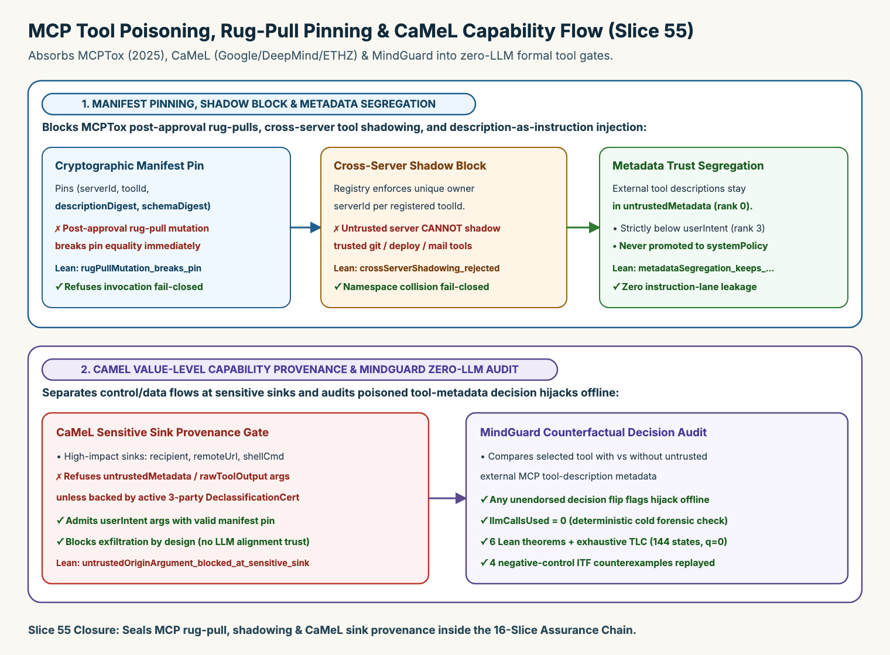

#+TITLE: 55: MCP Tool Poisoning, Rug-Pull Manifest Pinning, Cross-Server Shadowing, and CaMeL Capability-Provenance Flow
#+AUTHOR: tao3k team and Contributors
#+DATE: 2026-11-24
# SPDX-FileCopyrightText: 2026 tao3k team and Contributors
# SPDX-License-Identifier: Apache-2.0 AND LGPL-2.1-or-later

* Scope: Closing the 2025–2026 Tool-Ecosystem & Capability-Flow Frontier

Slices =50=–=51= closed indirect prompt-injection return channels (APPA confined
detours, NeuroTaint counterfactual audit) and persistent memory poisoning
(MINJA/MemoryGraft quarantine). Recent 2025–2026 security research exposes a
distinct, orthogonal attack surface at the **external tool / MCP boundary**:

1. *MCP Tool Poisoning & Post-Approval Rug-Pulls* (*MCPTox*, =arXiv:2508.14925=,
   2025): malicious or compromised MCP servers hide adversarial instructions in
   natural-language tool descriptions/schemas or silently mutate a tool's
   descriptor *after* initial user/policy approval (a "rug-pull"), achieving
   >70–90% attack success rates even on frontier reasoning models.
2. *Cross-Server Tool Shadowing*: an untrusted MCP server registers a colliding
   tool name or embeds cross-server invocation instructions inside its metadata
   to hijack calls intended for a trusted server (e.g., =git=, =email=, =deploy=).
3. *Control/Data Flow Separation & Value-Level Capability Provenance* (*CaMeL:
   Defeating Prompt Injections by Design*, Debenedetti et al., Google /
   DeepMind / ETH Zurich, =arXiv:2503.18813=, 2025): tracking provenance on
   every data value ensures untrusted tool outputs or tool metadata can never
   rewrite control flow or populate high-impact sink parameters (such as
   =recipient=, =remoteUrl=, or =shellCmd=) without an explicit capability or
   declassification policy.
4. *Decision-Dependence Guardrails* (*MindGuard*, =arXiv:2508.20412=, 2025):
   segregating tool descriptions out of trusted instruction lanes and auditing
   whether untrusted metadata flipped the selected tool or sink argument.

Slice =55= formalizes all four defenses in SysML v2, Lean 4, and Quint
(exhaustive TLC), and anchors the runtime POO tool-registry & capability-flow
gate in =modules/ai-agentic-context/funs-trust-lattice.ss=.

* Four Formal Contracts Absorbed in Slice 55

| Defense Layer | Primary-Source Anchor | Formal Guarantee (Lean 4 + Quint TLC) |
|---------------+-----------------------+---------------------------------------|
| 1. Cryptographic Manifest Pinning | *MCPTox* (=arXiv:2508.14925=) | Tool invocation requires exact match against the pinned =(serverId, toolId, descriptionDigest, schemaDigest)= manifest; any post-approval rug-pull mutation breaks equality and fails closed (=rugPullMutation_breaks_manifest_pin=). |
| 2. Cross-Server Namespace Isolation | *MCPTox* / OWASP MCP | A tool registry refuses any registration whose =toolId= collides with an existing distinct =serverId= (=crossServerShadowing_rejected_fail_closed=); untrusted metadata stays strictly below =userIntent= trust rank (=metadataSegregation_keeps_description_untrusted=). |
| 3. CaMeL Argument Provenance & Sensitive Sink Gate | *CaMeL* (=arXiv:2503.18813=) | High-impact sinks refuse arguments originating from =untrustedMetadata= or =rawToolOutput= unless accompanied by a valid active 3-party =DeclassificationCert= (=untrustedOriginArgument_blocked_at_sensitive_sink=). |
| 4. Zero-LLM Decision-Dependence Audit | *MindGuard* (=arXiv:2508.20412=) + Slice =50= | Counterfactual audit comparing tool choice with vs without untrusted tool metadata flags any unendorsed decision flip (=decisionDependenceAudit_flags_unendorsed_metadata_hijack=) at zero LLM cost. |

* Orthogonal Verification Split (=FormalVerificationTaxonomy=)

In [[file:55-mcp-tool-poisoning-and-camel-capability-flow.sysml][55-mcp-tool-poisoning-and-camel-capability-flow.sysml]], all obligations obey
the strict XOR dispatch rule from [[file:40-context-governance-boundary.sysml][Slice 40]]:

- *Lean 4 Unbounded Algebraic & Structural Obligations* ([[file:55-mcp-tool-poisoning-and-camel-capability-flow.lean][55-*.lean]]):
  1. =toolManifestPinningAndShadowingLaw=:
     - =rugPullMutation_breaks_manifest_pin=
     - =crossServerShadowing_rejected_fail_closed=
     - =metadataSegregation_keeps_description_untrusted=
  2. =camelCapabilityProvenanceAndSinkLaw=:
     - =untrustedOriginArgument_blocked_at_sensitive_sink=
     - =userIntentArgument_admitted_at_sensitive_sink=
     - =decisionDependenceAudit_flags_unendorsed_metadata_hijack=
- *Quint Nondeterministic Concurrent Interleaving Obligations* ([[file:55-mcp-tool-poisoning-and-camel-capability-flow.qnt][55-*.qnt]]):
  1. =mcpRugPullShadowingAndCapabilityFlowRace=:
     - =rugPullMutatedToolNeverInvoked=
     - =crossServerShadowedToolNeverDispatched=
     - =sensitiveSinkNeverAcceptsUntrustedOriginWithoutCert=
     - =poisonedMetadataDecisionHijackAlwaysFlaggedOffline=
  2. Four standalone =buggy*= negative-control counterexample runs reproduce
     post-approval rug-pull invocation, cross-server tool shadowing, untrusted
     argument exfiltration at a sensitive sink, and unflagged metadata decision
     hijacking, exporting real ITF JSON traces replayed into SysML
     =QuintTraceScalarReplayContract=.

* Illustrated Architecture View

Rendered via OpenSysML + =@deterministic-engineering/render= ([[file:../../../../dev/d2/governance-illustrations.ts][governance-illustrations.ts]] + [[file:../../../../dev/d2/governance-figures.sysml][governance-figures.sysml]]):

#+CAPTION: Slice 55 — MCP Tool Poisoning, Rug-Pull Pinning, Cross-Server Shadowing & CaMeL Capability-Provenance Flow

* Capstone Composition

[[file:47-end-to-end-context-governance-assurance-closure.org][Slice 47]]
imports =McpToolPoisoningAndCamelCapabilityFlow= as the fifteenth upstream
plane (=40..46, 48..55 -> 47=), ensuring external tool invocation and argument
provenance fail closed end to end.
