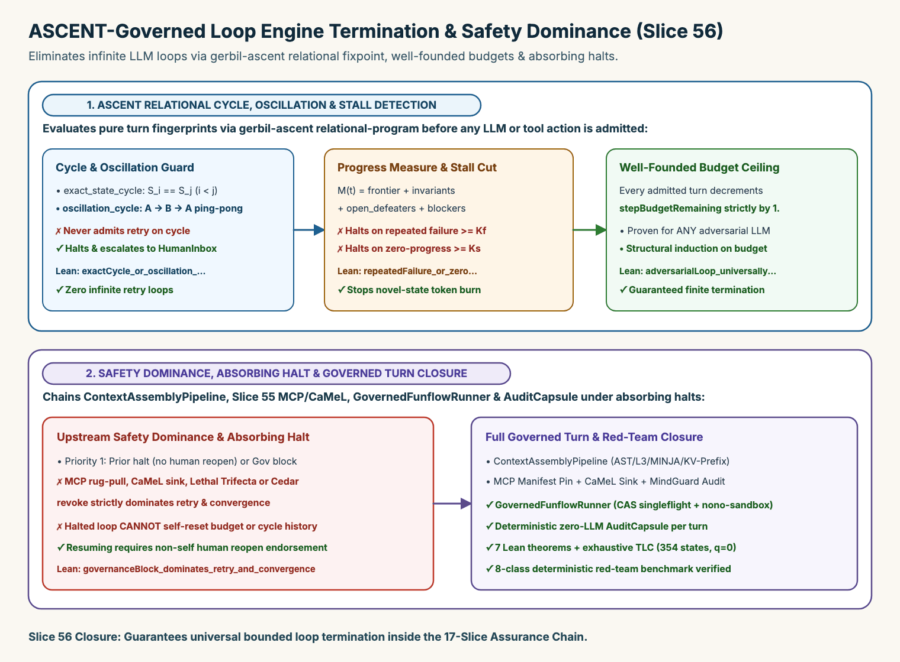

#+title: Slice 56: ASCENT-Governed Loop Engine Termination, Anti-Oscillation & Safety Dominance
#+date: [2026-11-24]
#+language: en
#+property: STATUS design-formal-proofs-and-runtime-verified
#+begin_comment
SPDX-FileCopyrightText: 2026 tao3k team and Contributors
SPDX-License-Identifier: Apache-2.0 AND LGPL-2.1-or-later
#+end_comment

* Why an ASCENT-Governed Loop Engine Eliminates Infinite Loops by Construction

Early imperative loop governors only filtered static denylists and single-key
collisions (=modules/loop-engine/control/governor-policy.ss=), leaving LLM
agent loops vulnerable to four real runaway failure classes:

1. *Exact state self-loops* ($S_i = S_j, i < j$);
2. *Ping-pong plan oscillations* ($A \to B \to A$ across non-adjacent turns);
3. *Repeated-failure thrashing & zero-progress token burn* (novel superficial
   outputs while the well-founded progress measure $M(t)$ never shrinks);
4. *Governance-block retry loops & self-reset bypasses* (retrying after MCP
   rug-pulls, CaMeL sink denials, Lethal Trifecta sandbox refusals, or
   self-resetting budget after halting).

Slice 56 replaces imperative loop control with a pure functional POO +
=gerbil-ascent= relational fixed-point governor
(=modules/loop-engine/ascent-termination.ss=) coupled to the end-to-end
governed turn engine (=modules/loop-engine/governed-loop.ss=).

* Verdict Priority Lattice & Well-Founded Termination Measure

Let $M(s) = \text{remainingFrontier} + \text{openInvariants} + \text{openDefeaters} + \text{openBlockers}$.
The ASCENT relational program derives five mutually exclusive halting predicates
ordered strictly above =admitNextStep=:

| Priority | Verdict | Trigger Condition | Runtime Consequence |
|----------+---------+-------------------+---------------------|
| 1 | =haltGovernanceBlocked= | Prior halt without human reopen, OR any Slice 50–55 / Cedar block | Fail-closed immediate halt; escalates to =HumanInbox=; zero retry |
| 2 | =haltConverged= | $M(s) = 0 \land \text{journalQuiescent}$ | Clean fixed-point stop; emits zero-LLM =AuditCapsule= |
| 3 | =haltCycleDetected= | =exact_state_cycle= ($S_i = S_j$) OR =oscillation_cycle= ($A \to B \to A$) | Immediate cycle halt; escalates to =HumanInbox=; zero retry |
| 4 | =haltStalledNoProgress= | =repeated_failure_signature= $\ge K_f$ OR =zero_progress_stall= $\ge K_s$ | Stall halt; emits zero-authority park/detour advisory |
| 5 | =haltBudgetExhausted= | $\text{stepBudgetRemaining} = 0 \lor \text{tokensRemaining} = 0$ | Hard monotonic ceiling guaranteeing universal finite termination |
| 6 | =admitNextStep= | None of 1–5 holds | Decrements budget by 1, runs =ContextAssemblyPipeline= + MCP/CaMeL + =GovernedFunflowRunner= |

#+begin_src typst
$ forall "adv", forall s, quad "stepBudgetRemaining"(s) <= k => "isHaltedVerdict"("runGovernedLoop"("adv", k, s)) = "true" $
#+end_src

* Visual Architecture & Mechanized Assurance

#+CAPTION: Slice 56 — ASCENT-Governed Loop Engine Termination, Anti-Oscillation & Safety-Dominance Closure

| Verification Layer | Artifact | Scope & Key Theorems / Invariants |
|--------------------+----------+-----------------------------------|
| SysML v2 Taxonomy & XOR Dispatch | [[file:56-ascent-governed-loop-termination.sysml][56-ascent-governed-loop-termination.sysml]] | =AscentLoopTerminationDispatchContract= mapping 7 Lean theorems + 4 Quint invariants |
| Lean 4 Kernel Proofs (=0 sorryAx=) | [[file:56-ascent-governed-loop-termination.lean][56-ascent-governed-loop-termination.lean]] | =adversarialLoop_universally_terminates=, =exactCycle_or_oscillation_always_halts=, =repeatedFailure_or_zeroProgress_always_halts=, =budgetExhausted_always_halts=, =governanceBlock_dominates_retry_and_convergence=, =haltedLoop_absorbing_without_human_reopen=, =convergedQuiescent_halts_cleanly= |
| Quint Exhaustive TLC + ITF Counterexamples | [[file:56-ascent-governed-loop-termination.qnt][56-ascent-governed-loop-termination.qnt]] | =cycleOrOscillationNeverAdmitsNextStep=, =governanceBlockNeverOverriddenByRetry=, =haltedLoopNeverSelfResetsWithoutHumanReopen=, =stepsTakenNeverExceedsInitialBudget= + 4 =buggy*= counterexamples |
| Runtime Implementation & Red-Team Benchmark | =modules/loop-engine/{ascent-termination,governed-loop}.ss= | Real =gerbil-ascent= relational program + 8-class deterministic red-team benchmark suite |

Reproduce standalone verification:

#+begin_src sh
just check-context-governance-lake
just check-context-governance-chain
just test-file t/yanxu/modules/loop-engine/ascent-governed-loop-red-team-test.ss
#+end_src
