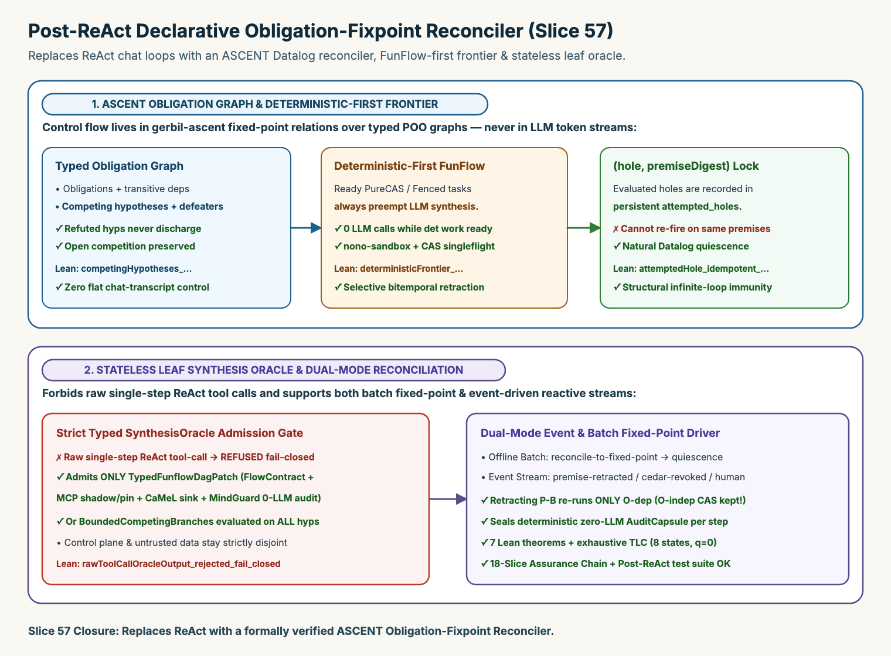

#+title: Slice 57: Post-ReAct Declarative Obligation-Fixpoint Reconciler (ASCENT × FunFlow × POO)
#+date: [2026-11-24]
#+language: en
#+property: STATUS design-formal-proofs-and-runtime-verified
#+begin_comment
SPDX-FileCopyrightText: 2026 tao3k team and Contributors
SPDX-License-Identifier: Apache-2.0 AND LGPL-2.1-or-later
#+end_comment

* Abandoning ReAct: Why ASCENT Must Be the Loop Engine, Not a Brake on ReAct

Community ReAct loops (=Think -> Act -> Observe -> Think=) embed control flow
inside an unstructured LLM token stream. Bolting cycle detectors or step caps
onto a ReAct shell only slows down a fundamentally broken control plane: the
LLM still steers the loop, mixes raw untrusted observations into control
decisions, burns tokens on deterministic work, and collapses competing
hypotheses into a single greedy trajectory.

Slice 57 replaces the imperative ReAct shell with a *Post-ReAct Declarative
Obligation-Fixpoint Reconciler* built directly on =gerbil-ascent=, =FunFlow=,
=gerbil-poo=, and =Temporal Causality=:

1. *Typed Obligation & Epistemic Graph (=modules/loop-engine/obligation-graph.ss=)*:
   World state is an immutable, content-addressed POO graph of =GoalObligation=,
   =CompetingHypothesis=, =EvidenceFact=, =DeterministicTaskNode=,
   =SynthesisHole=, and persistent =attempted-holes= tuples — never a flat chat
   transcript.
2. *ASCENT Fixed-Point Reconciler (=modules/loop-engine/ascent-reconciler.ss=)*:
   A real =gerbil-ascent= Datalog program computes the entire execution frontier
   in one fixed point: =discharged_obligation=, =refuted_hypothesis=,
   =ready_deterministic_task=, =ready_synthesis_hole=, =blocked_on_human=, and
   =quiescent_fixed_point=.
3. *Structural Loop Immunity via =(holeId, premiseDigest)= Idempotence*:
   Once a synthesis hole is evaluated under a premise digest, the tuple is
   recorded permanently in =attempted_holes=. Datalog *cannot* re-derive that
   hole unless an external event or bitemporal premise retraction changes its
   premise digest.
4. *Stateless Typed Leaf =SynthesisOracle= (=modules/loop-engine/synthesis-oracle.ss=)*:
   Raw single-step ReAct tool calls are rejected fail-closed. The LLM is woken
   *only* when the deterministic FunFlow frontier is empty and an unattempted
   synthesis hole remains, and may emit *only* (a) contract/CaMeL/MCP-verified
   =TypedFunflowDagPatch= objects or (b) =BoundedCompetingBranches= evaluated
   against every active hypothesis.
5. *Dual-Mode Reconciliation*: Supports both *offline batch convergence* to
   quiescent fixed point (=reconcile-to-fixed-point=) and *event-driven
   incremental reconciliation* (=reconcile-event-stream=) over Durable Work /
   Journal events with selective bitemporal invalidation.

#+begin_src typst
$ forall "attempted", forall "queue", forall h in "queue", quad
  "isReadySynthesisHole"("reconcileHoleQueue"("attempted", "queue"), 0, "true", h) = "false" $
#+end_src

* Visual Architecture & Mechanized Assurance

#+CAPTION: Slice 57 — Post-ReAct Declarative Obligation-Fixpoint Reconciler (ASCENT × FunFlow × Typed SynthesisOracle)

| Verification Layer | Artifact | Scope & Key Theorems / Invariants |
|--------------------+----------+-----------------------------------|
| SysML v2 Taxonomy & XOR Dispatch | [[file:57-obligation-fixpoint-reconciler.sysml][57-obligation-fixpoint-reconciler.sysml]] | =ObligationReconcilerDispatchContract= mapping 7 Lean theorems + 4 Quint invariants |
| Lean 4 Kernel Proofs (=0 sorryAx=) | [[file:57-obligation-fixpoint-reconciler.lean][57-obligation-fixpoint-reconciler.lean]] | =attemptedHole_idempotent_on_unchanged_premises=, =deterministicFrontier_takes_strict_precedence_over_llm=, =refutedHypothesis_never_discharges_obligation=, =competingHypotheses_preserved_without_greedy_collapse=, =rawToolCallOracleOutput_rejected_fail_closed=, =premiseRetraction_preserves_independent_nodes=, =reconciler_reaches_quiescent_fixed_point_on_all_holes= |
| Quint Exhaustive TLC + ITF Counterexamples | [[file:57-obligation-fixpoint-reconciler.qnt][57-obligation-fixpoint-reconciler.qnt]] | =sameHolePremiseNeverReinvokesOracle=, =llmOracleNeverCalledWhileDeterministicFrontierNonEmpty=, =rawSingleStepToolCallNeverAdmittedFromOracle=, =competingHypothesesNeverCollapsedWhenUnrefuted= + 4 =buggy*= counterexamples |
| Runtime Implementation & Red-Team Suite | =modules/loop-engine/{obligation-graph,ascent-reconciler,synthesis-oracle}.ss= | Real =gerbil-ascent= obligation reconciler + dual-mode driver + Post-ReAct test suite |

Reproduce verification:

#+begin_src sh
just check-context-governance-lake
just check-context-governance-chain
just test-file t/yanxu/modules/loop-engine/obligation-reconciler-test.ss
#+end_src
