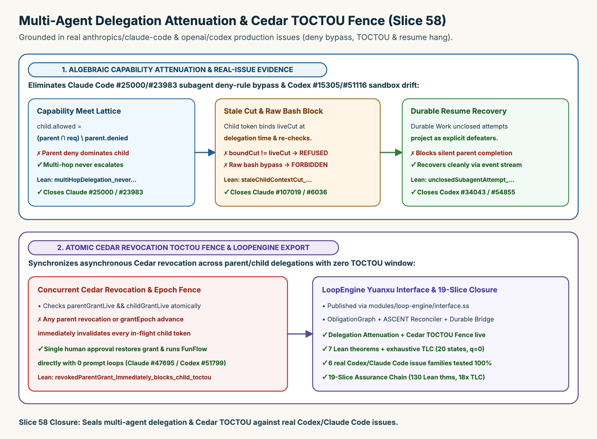

#+title: Slice 58: Multi-Agent Delegated Obligation Attenuation & Concurrent Cedar Revocation TOCTOU Fence
#+date: [2026-11-24]
#+language: en
#+property: STATUS design-formal-proofs-and-runtime-verified
#+begin_comment
SPDX-FileCopyrightText: 2026 tao3k team and Contributors
SPDX-License-Identifier: Apache-2.0 AND LGPL-2.1-or-later
#+end_comment

* Real-World Evidence Chain: Hard Issues from =anthropics/claude-code= and =openai/codex=

Rather than inventing synthetic benchmarks, Slice 58 and the Post-ReAct
=ObligationGraph= reconciler directly address documented production failure
modes across real agent runtimes:

| Documented Issue Class | Upstream Reference | Root Architectural Cause | Mechanized Defense in =agentic-ai-lab= |
|------------------------+--------------------+--------------------------+----------------------------------|
| Subagent deny-rule bypass & missing permission hooks | =anthropics/claude-code#25000=, =#23983= | Spawned subagents inherit loose/divergent permissions instead of algebraic capability meet | =attenuateEnvelope= (`parent ∩ req \ deny`) + Lean =parentDenylist_dominates_child_delegation= |
| Stale subagent workspace & indirect bash bypass | =anthropics/claude-code#107019=, =#6036= | Child executes on stale git/workspace state or raw shell tool calls | =SynthesisOracle= forbids raw ReAct tool calls (Slice 57) + atomic =boundCut == liveCut= fence |
| Session resume deadlock / infinite "Processing" hang | =openai/codex#34043=, =#54855= | Interrupted/paused subagent attempts leave parent waiting forever with no recovery predicate | Durable Work → =ObligationGraph= bridge (=durable-event-bridge.ss=) turns =unclosed-attempts= into explicit recovery defeaters |
| Autocompact thrashing & self-fix infinite loops | =claude-code#6004=, =#2222=, =#9766=; =codex#20830=, =#26745= | Linear ReAct transcript retries on unchanged premises without fixed-point idempotence | Slice 57 =(holeId, premiseDigest)= Datalog idempotence + Two-Zone Frozen KV-Prefix (Slice 51) |
| Sandbox override drift & MCP approval prompt loops | =openai/codex#51116=, =#15305=, =#51799=; =claude-code#47695= | Parent/child policy drift and un-fenced asynchronous grant changes (TOCTOU) | Atomic Cedar =boundGrantEpoch == liveGrantEpoch= + =parentGrantLive= check (=delegation-fence.ss=) |

#+begin_src typst
$ "capPermitted"("attenuateEnvelope"(p, r, d), c) = "true" => "capPermitted"(p, c) = "true",
  quad (c in p."denied") => "capPermitted"("attenuateEnvelope"(p, r, d), c) = "false" $
#+end_src

* Visual Architecture & Mechanized Assurance

#+CAPTION: Slice 58 — Multi-Agent Delegation Attenuation, Concurrent Cedar TOCTOU Fence & Real-World Issue Closure

| Verification Layer | Artifact | Scope & Key Theorems / Invariants |
|--------------------+----------+-----------------------------------|
| SysML v2 Taxonomy & XOR Dispatch | [[file:58-delegation-attenuation-and-cedar-toctou-fence.sysml][58-delegation-attenuation-and-cedar-toctou-fence.sysml]] | =DelegationToctouDispatchContract= mapping 7 Lean theorems + 4 Quint invariants |
| Lean 4 Kernel Proofs (=0 sorryAx=) | [[file:58-delegation-attenuation-and-cedar-toctou-fence.lean][58-delegation-attenuation-and-cedar-toctou-fence.lean]] | =delegatedCapability_never_exceeds_parent=, =parentDenylist_dominates_child_delegation=, =multiHopDelegation_never_escalates=, =revokedParentGrant_immediately_blocks_child_toctou=, =grantEpochAdvance_invalidates_inflight_delegation=, =staleChildContextCut_rejected_fail_closed=, =unclosedSubagentAttempt_blocks_silent_hang_or_completion= |
| Quint Exhaustive TLC + ITF Counterexamples | [[file:58-delegation-attenuation-and-cedar-toctou-fence.qnt][58-delegation-attenuation-and-cedar-toctou-fence.qnt]] | =delegatedChildNeverBypassesParentDenylist=, =revokedGrantOrStaleCutNeverAdmitsChildToctou=, =parentNeverCompletesWhileChildAttemptUnclosed=, =childBoundEpochNeverExceedsLiveGrantEpoch= + 4 real-issue =buggy*= counterexamples |
| Runtime Modules & Real-Issue Test Suite | =modules/loop-engine/{durable-event-bridge,delegation-fence}.ss= | Projects Durable Work snapshots/events onto =ObligationGraph= + enforces multi-hop attenuation & Cedar TOCTOU fences |

Reproduce verification:

#+begin_src sh
just check-context-governance-lake
just check-context-governance-chain
just test-file t/yanxu/modules/loop-engine/obligation-reconciler-test.ss
just test-file t/yanxu/modules/loop-engine/real-issue-evidence-chain-test.ss
#+end_src
