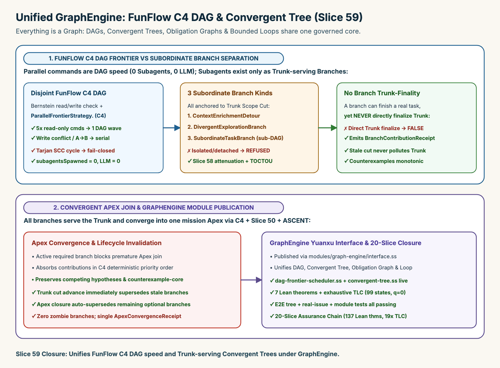

#+title: Slice 59: Unified GraphEngine — FunFlow C4 Disjoint DAG Frontier & Shared-Context Convergent Tree
#+date: [2026-11-25]
#+language: en
#+property: STATUS design-formal-proofs-and-runtime-verified
#+begin_comment
SPDX-FileCopyrightText: 2026 tao3k team and Contributors
SPDX-License-Identifier: Apache-2.0 AND LGPL-2.1-or-later
#+end_comment

* Unified GraphEngine Paradigm: Everything is a Graph

Rather than treating a linear ReAct loop as the top-level runtime shell,
=modules/graph-engine/= unifies all agentic execution patterns as governed
graph topologies:

1. *Acyclic FunFlow C4 DAG Frontier (=dag-frontier-scheduler.ss=)*: causal
   dependencies (=Task A -> Task B=) and overlapping write footprints strictly
   serialize under C4 =OrchestratorStrategy.=, whereas disjoint read-only
   commands fan out in a single parallel DAG wave with *0 subagents* and *0 LLM*
   orchestration calls.
2. *Shared-Context Convergent Tree (=convergent-tree.ss=)*: there are *zero*
   isolated/unshared subagents. Every branch grows from the shared
   =ContextTrunk= (=shared-context-cut=, =kv-prefix-digest=, =serving-apex-id=)
   with an attenuated Slice 58 capability envelope across 3 subordinate kinds:
   - =ContextEnrichmentDetour.= (acquires missing upstream/downstream context)
   - =DivergentExplorationBranch.= (explores competing hypotheses on the shared prefix)
   - =SubordinateTaskBranch.= (executes & completes a branch-scoped task / sub-DAG)
3. *Subordinate Finality & Convergent Apex*: a branch can complete a concrete
   local task, yet is *never* the Trunk and can *never* finalize the Trunk
   directly. All branches exist strictly to serve the Trunk and converge into
   the single mission Apex via C4 priority ordering, Slice 50 4-Exit absorption,
   and ASCENT relational obligation reconciliation.
4. *Bounded Cyclic Feedback (Loop as a Graph Specialization)*: bounded iterative
   reconciliation is simply a governed cyclic subgraph whose termination is
   enforced by relational =(hole-id, premise-digest)= idempotence and Tarjan SCC
   cycle admission.

#+begin_src typst
$ "branchDirectTrunkFinalization"(o) = "false",
  quad ("hasWriteConflict" = "false" and "hasCausalEdge" = "false") => "subagentsSpawned" = 0 $
#+end_src

* Visual Architecture & Mechanized Assurance

#+CAPTION: Slice 59 — Unified GraphEngine: FunFlow C4 DAG Frontier & Shared-Context Convergent Tree

| Verification Layer | Artifact | Scope & Key Theorems / Invariants |
|--------------------+----------+-----------------------------------|
| SysML v2 Taxonomy & XOR Dispatch | [[file:59-graph-engine-convergent-tree-and-apex-join.sysml][59-graph-engine-convergent-tree-and-apex-join.sysml]] | =ConvergentTreeDispatchContract= mapping 7 Lean theorems + 4 Quint invariants |
| Lean 4 Kernel Proofs (=0 sorryAx=) | [[file:59-graph-engine-convergent-tree-and-apex-join.lean][59-graph-engine-convergent-tree-and-apex-join.lean]] | =disjointParallelDagFrontier_spawns_zero_subagents=, =overlappingWriteFootprint_never_parallelized=, =isolatedOrDetachedBranch_always_refused=, =branchCompletion_never_finalizes_trunk_directly=, =staleBranchContribution_never_pollutes_trunk_yet_preserves_counterexamples=, =unclosedRequiredBranch_blocks_apex_convergence=, =apexConvergence_supersedes_remaining_optional_branches= |
| Quint Exhaustive TLC + ITF Counterexamples | [[file:59-graph-engine-convergent-tree-and-apex-join.qnt][59-graph-engine-convergent-tree-and-apex-join.qnt]] | =parallelDagNeverSpawnsSubagents=, =noIsolatedUnsharedSubagentSpawned=, =subordinateBranchNeverDirectlyFinalizesTrunk=, =apexConvergenceClearsOptionalAndRequiresZeroActiveBranches= + 4 negative-control counterexamples |
| Unified GraphEngine Runtime & E2E Tests | =modules/graph-engine/{interface,dag-frontier-scheduler,convergent-tree}.ss= | Published as =(.get Lab graph-engine)=; verified by =t/yanxu/modules/graph-engine/*-test.ss= |

Reproduce verification:

#+begin_src sh
just check-context-governance-lake
just check-context-governance-chain
just test-file t/yanxu/modules/graph-engine/module-test.ss
just test-file t/yanxu/modules/graph-engine/convergent-tree-e2e-test.ss
#+end_src
