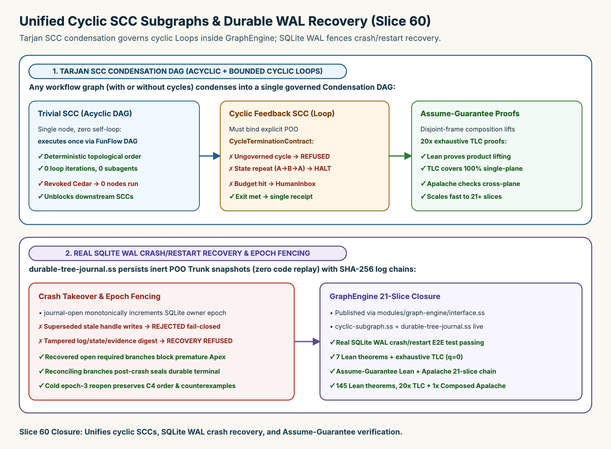

#+title: Slice 60: Unified GraphEngine — Tarjan SCC Cyclic Feedback Subgraphs & Durable SQLite WAL Crash Recovery
#+date: [2026-11-25]
#+language: en
#+property: STATUS design-formal-proofs-and-runtime-verified
#+begin_comment
SPDX-FileCopyrightText: 2026 tao3k team and Contributors
SPDX-License-Identifier: Apache-2.0 AND LGPL-2.1-or-later
#+end_comment

* Unifying Cyclic Subgraphs (Loops) and Crash-Resilient Persistence under =GraphEngine=

Slice 60 completes two pillars of =modules/graph-engine/=:

1. *Tarjan SCC Condensation for Acyclic + Cyclic Graphs (=cyclic-subgraph.ss=)*:
   Every workflow graph is condensed into a Condensation DAG of Strongly
   Connected Components:
   - Trivial SCCs (no cycle) execute once as deterministic DAG nodes.
   - Non-trivial cyclic SCCs (bounded feedback / repair loops) *must* carry an
     explicit POO =CycleTerminationContract.=; ungoverned cycles fail closed,
     state-digest repeats (=A -> B -> A= oscillation) halt immediately, and
     exhausted budgets escalate cleanly before releasing downstream DAG nodes.
2. *Real SQLite WAL Crash/Restart Recovery (=durable-tree-journal.ss=)*:
   Connects =convergent-tree.ss= onto =modules/temporal-causality/runtime/durable-journal.ss=:
   - Persists inert POO Trunk snapshots (zero code replay) + immutable evidence
     + tamper-evident SHA-256 hash-chained logs + Apex terminals.
   - Reopening after a crash monotonically increments the SQLite owner epoch,
     fencing out any superseded zombie process handle, verifying the entire
     hash chain, and blocking premature post-crash Apex convergence until all
     recovered open required branches are reconciled.

#+begin_src typst
$ "isCyclic" = "true" and "hasContract" = "false" => "admitSccExecution" = "false",
  quad "handleEpoch" != "liveOwnerEpoch" => "admitDurableCommit" = "false" $
#+end_src

* Visual Architecture & Mechanized Assurance

#+CAPTION: Slice 60 — Unified Tarjan SCC Cyclic Subgraphs & Durable SQLite WAL Crash Recovery

| Verification Layer | Artifact | Scope & Key Theorems / Invariants |
|--------------------+----------+-----------------------------------|
| SysML v2 Taxonomy & XOR Dispatch | [[file:60-unified-cyclic-scc-and-durable-tree-recovery.sysml][60-unified-cyclic-scc-and-durable-tree-recovery.sysml]] | =CyclicSccDurableRecoveryDispatchContract= mapping 7 Lean theorems + 4 Quint invariants |
| Lean 4 Kernel Proofs (=0 sorryAx=) | [[file:60-unified-cyclic-scc-and-durable-tree-recovery.lean][60-unified-cyclic-scc-and-durable-tree-recovery.lean]] | =ungovernedCyclicScc_always_refused=, =repeatedStateDigest_immediately_halts_oscillation=, =budgetExhaustedCycle_halts_fail_closed=, =revokedCedarGrant_blocks_unified_graph=, =supersededJournalEpoch_rejected_fail_closed=, =tamperedJournalHashChain_refuses_recovery=, =recoveredOpenRequiredBranches_block_premature_apex= |
| Quint Exhaustive TLC + ITF Counterexamples | [[file:60-unified-cyclic-scc-and-durable-tree-recovery.qnt][60-unified-cyclic-scc-and-durable-tree-recovery.qnt]] | =ungovernedCycleNeverExecutes=, =oscillatingCycleNeverContinues=, =supersededEpochNeverWritesJournal=, =postCrashApexRequiresZeroOpenBranchesAndConvergedScc= + 4 negative-control counterexamples |
| Runtime Modules & Crash/SCC Test Suites | =modules/graph-engine/{cyclic-subgraph,durable-tree-journal}.ss= | Verified by =t/yanxu/modules/graph-engine/{cyclic-subgraph-test,durable-tree-crash-recovery-test}.ss= |

Reproduce verification:

#+begin_src sh
just check-context-governance-lake
just check-context-governance-chain
just test-file t/yanxu/modules/graph-engine/cyclic-subgraph-test.ss
just test-file t/yanxu/modules/graph-engine/durable-tree-crash-recovery-test.ss
#+end_src
